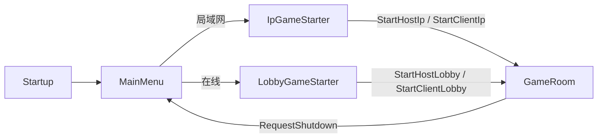
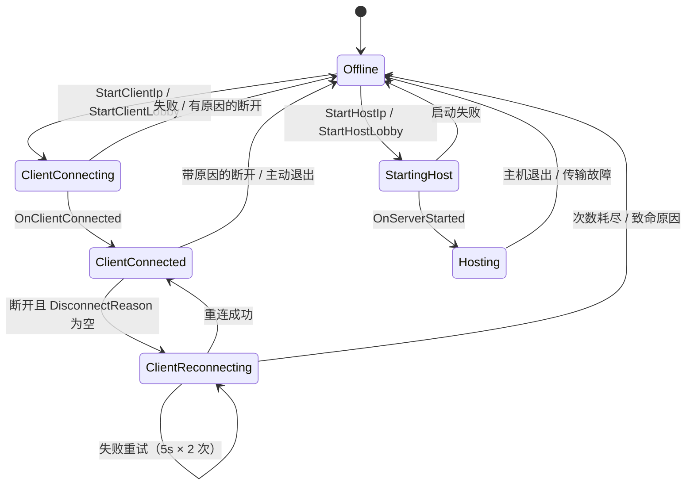

# 《中国传统文化交流》—— 局域网麻将 Unity 项目 · 架构与技术总结

> **文档性质**：基于源码通读的架构说明（非设计文档复述）。
> **基线版本**：`ProjectSettings/ProjectVersion.txt` = Unity **2022.3.17f1c1**；Git 末次提交 `eb96e36`（2024-04-23），共 56 次提交（2023-03-14 起）。
> **分析方式**：全量阅读 `Assets/Scripts` 下 183 个 C# 文件，辅以 3 份模块级精读笔记（见附录 D）。
> **阅读建议**：先看 §1 速览与 §4 分层总览，再按兴趣跳到 §5（规则）、§6（联机）、§7（表现）。

---

## 1. 项目速览

### 1.1 它是什么

一个 **Unity 2022.3 LTS** 开发的 **四人麻将（简化地方规则，无立直/无花牌）** 网络游戏，支持两种开局方式：

| 模式 | 入口场景 | 依赖云服务 | 说明 |
| --- | --- | --- | --- |
| **局域网 IP 直连** | `IpGameStarter.unity` | ❌ 不需要 | 房主监听 `0.0.0.0:9988`，其他人输入房主 IP 加入；**单人游玩即"自己建房 + 加 3 个 Bot"** |
| **在线大厅（Lobby + Relay）** | `LobbyGameStarter.unity` | ✅ Unity Gaming Services | 创建/按房间码加入/快速加入，流量经 Relay 中继（DTLS） |

游戏规则要点（从代码提取，非文档）：

- 4 人固定座位（`MahjongUtils.MaxConnectedPlayers = 4`）；万 / 筒 / 条 / 风 / 箭 五类，无花牌；每种牌 4 张（`GameDataSource.MaximumForEachCardType`）。
- **鬼牌（Joker）＝ 红中**（`SuitType.Dragon` 且 `Rank == 1`，`MahjongGameRuleTrigger.cs:29`）；手牌插入时按 `Card.Id` 有序，鬼牌被单独归位到列表最前（`Player.CalculateCardIndex`，`Player.cs:123`）。
- **全场 8 局**（`TotalRounds = 8`），随机定庄，赢家非庄则赢家坐庄；每回合限时 60s（`Timeout = 60`）。
- 技能（Skills）只有 4 个：**碰、杠（明杠/暗杠/补杠三合一）、自摸、自摸·七对**。
- 计分走"番种位域"枚举：自摸 / 无鬼 / 杠上开花 / 七对 / 暗杠 / 明杠 / 点杠 / 承包等（`ScoreActionType`）。

### 1.2 规模

| 维度 | 数值 |
| --- | --- |
| C# 源码 | **183 个文件 / ≈15,000 行**（`Assets/Scripts`，另 8 个 DOTween 插件脚本） |
| 程序集（asmdef） | **9 个**自定义程序集（+ DOTween.Modules） |
| 场景 | 5 个（Startup / MainMenu / LobbyGameStarter / IpGameStarter / GameRoom） |
| 预制体 | 66 个（卡牌 4 方向 × 5 类型、玩家区 4 向、UI、状态、动画…） |
| ScriptableObject 数据 | 66 个（34 张牌定义、5 花色、4 技能、14 头像、技能注册表…） |
| 运行时查表资源 | 6 个 `.bytes`，合计 **≈15 MB**（胡牌字典 + AI 牌效字典），MessagePack 编码 |
| 美术 / 音频 | Textures 13 MB、Fonts 19 MB、Resources 19 MB（含 34 条中文牌名语音 ×2 音色） |
| 第三方 | Netcode for GameObjects 1.7.1、VContainer 1.13.1、UniTask 2.3.3、MessagePack 2.5.1、DOTween、UGS Lobby/Relay/Auth、ParrelSync（多开调试） |
| 自动化测试 | **无**（有 test-framework 包，但无测试代码） |

### 1.3 技术栈

| 层 | 技术 | 用到的地方 |
| --- | --- | --- |
| 引擎 | Unity 2022.3.17f1c1，**内置渲染管线**，Gamma 色彩空间，正交相机（size 5） | 全项目 |
| 2D/UI | uGUI（ScreenSpaceOverlay）+ SpriteRenderer 牌面 + TextMeshPro + 自研 `SwitchButton` | 牌桌、菜单、结算 |
| 网络 | **Unity Netcode for GameObjects 1.7.1**（`NetworkManager` TickRate 30、开启 ConnectionApproval、`UnityTransport`/UTP） | 房间同步 |
| 云服务 | UGS Authentication（匿名登录）/ Lobby（房间发现）/ Relay（NAT 穿透中继） | 在线模式 |
| DI | **VContainer 1.13.1**：根作用域 + 每场景一个 `LifetimeScope` | 全局与各状态 |
| 异步 | **UniTask**（规则主循环、UI 动画、取消令牌） | 几乎所有流程控制 |
| 序列化 | Netcode 原生 `INetworkSerializable` + 自定义 `NetworkVariable` 序列化 + **MessagePack**（仅算牌表）+ JsonUtility（连接载荷） | 见 §8 |
| 动画 | DOTween（表现）+ Coroutine（倒计时）+ UniTask（可取消动画） | UI / 卡牌 |
| 架构范式 | **服务端权威 + 事件驱动触发器 + 代理/适配模式**（骨架源自 Unity 官方 **Boss Room** 示例） | 规则层 |

> **重要背景**：启动链、连接状态机、Lobby 门面、`GameStateBehaviour`、`UpdateRunner`、PubSub 总线、`RuntimeCollection`、`ClientLoadingScreen`、`SceneBootstrapper` 等均可追溯到 Boss Room 示例；麻将相关的 `GameRule`、`Algorithm`、`GameplayObjects`、`UI/` 大部分为本项目原创。文档中"遗留"与"自研"已在 §12 区分。

---

## 2. 工程结构

### 2.1 目录

```
Assets/
├─ Scenes/            Startup(常驻引导) / MainMenu / LobbyGameStarter / IpGameStarter / GameRoom
├─ Scripts/           ← 全部 C#（9 个 asmdef）
│  ├─ ApplicationLifecycle/   根 LifetimeScope（ApplicationController）+ 退出消息
│  ├─ Audio/                  Mixer 配置、音乐、音效/语音播放（4 个常驻单例）
│  ├─ ConnectionManagement/   连接状态机 + 两种 ConnectionMethod + SessionManager
│  ├─ Gameplay/               ← 主体（131 文件 / 10.5k 行）
│  │  ├─ GameRule/            规则内核：Cards / Players / Skills / Triggers / Games
│  │  ├─ Algorithm/           胡牌/牌效查表的数据结构（MessagePack）
│  │  ├─ GameplayObjects/     视图与运行时容器（GameView/PlayerView/Card*/Algorithm 检测器）
│  │  ├─ GameState/           四个场景状态（Client*/Server*）+ NetworkGameState
│  │  ├─ Configuration/       ScriptableObject 配置（牌、花色、技能、头像、昵称）
│  │  ├─ Serialization/       Netcode 自定义序列化 + MessagePack 注册 + 生成代码
│  │  └─ UI/                  菜单、弹窗、设置、房间/结算 UI、GameStarter Mediator
│  ├─ Infrastructure/         UpdateRunner、PubSub、场景加载、RuntimeCollection、NetworkGuid
│  ├─ UnityServices/          Auth / Lobby 门面与本地镜像
│  ├─ Utils/                  Profile、ClientPrefs、BotCounter、座位换算
│  └─ Editor/                 SceneBootstrapper、BitmapFontExporter
├─ Prefabs/           Card/ Character/ Skill/ UI/ State/ Animation/（66 个）
├─ GameData/          ScriptableObject 资产（牌定义/花色/技能资源/头像）
├─ Resources/         Algorithm/*.bytes（15MB 查表）+ Sounds/Mandarin/**（语音）
├─ Plugins/           DOTween、System.Runtime.CompilerServices.Unsafe 等
├─ Textures/ Fonts/ Sounds/ Animations/ TextMesh Pro/
```

### 2.2 程序集划分

9 个自定义 asmdef 把工程切成清晰层次，依赖方向**单向向下**：

```
                        ┌────────────────────────────┐
                        │ LoveMe.Mahjong.ApplicationLifecycle │  根作用域/全局服务
                        └───────────────┬────────────┘
                                        │
        ┌───────────────────────────────┼───────────────────────────┐
        ▼                               ▼                           ▼
┌──────────────────┐         ┌────────────────────┐      ┌────────────────────┐
│ LoveMe.Mahjong.  │         │ LoveMe.Mahjong.    │      │ LoveMe.Mahjong.    │
│ ConnectionMgmt   │◀────────│ Gameplay           │      │ UnityServices      │
│ (状态机/传输)     │         │ (规则+视图+UI)      │      │ (Auth/Lobby/Relay) │
└────────┬─────────┘         └─────────┬──────────┘      └─────────┬──────────┘
         │                             │                           │
         ▼                             ▼                           ▼
┌────────────────────┐        ┌────────────────────┐      ┌──────────────┐
│ Infrastructure     │        │ Audio              │      │ Utils        │
│ (PubSub/加载/工具)  │        │ (混音/播放)         │      │ (座位/配置)   │
└────────────────────┘        └────────────────────┘      └──────────────┘
```

- `Gameplay` 依赖 `ConnectionManagement`（发起连接/退出）、`Infrastructure`、`UnityServices`、`Audio`、`Utils`、VContainer/UniTask/MessagePack/DOTween。
- `ConnectionManagement` **不**依赖 `Gameplay` 实现（asmdef 里只引用了一个并不存在的 `LoveMe.Mahjong.Gameplay.Messages` 程序集，属残留引用，见 §12）。
- `Infrastructure` 是最底层，只依赖 Netcode/VContainer。
- `Editor` 独立，仅 Editor 平台。

> 这套切分让"规则层可脱离 Unity 编译"成为可能（见 §11 亮点 1），但 `Gameplay` 仍是单一巨型程序集，规则与视图没有物理隔离。

---

## 3. 运行时骨架：启动、场景与状态

### 3.1 启动链

`Startup.unity`（Build Settings 第 0 个场景）是唯一常驻引导场景，内含：

```
Startup
├─ Main (ApplicationController : LifetimeScope)   ← 根 DI 容器，DontDestroyOnLoad
├─ NetworkManager (Netcode)                        ← DontDestroyOnLoad
├─ UpdateRunner                                    ← 统一 Update 分发
├─ SceneLoaderWrapper / LoadingProgress            ← 网络场景加载 + 进度条
├─ GameDataSource                                  ← 静态牌/技能数据源（单例）
├─ WinningCardDetector / BotDecisionMaker          ← 算法单例（异步载表）
├─ CustomSerializationRegister                     ← Netcode 自定义序列化注册
├─ ClientMusicPlayer / ClientSFXPlayer / ClientAudioPlayer
└─ EventSystem / UIMessageManager
```

启动顺序（`ApplicationController.cs`）：

1. `Configure`：向根容器注册 `NetworkManager`、`ConnectionManager`、`UpdateRunner`、`LocalLobby`/`LocalLobbyUser`、`ProfileManager`、`BotCounter`、`AuthenticationServiceFacade`、`LobbyServiceFacade`，以及**一整套消息通道**（`QuitApplicationMessage`、`ConnectStatus`、`ReconnectMessage`、`LobbyListFetchedMessage`、`UnityServiceErrorMessage`、`NetworkedMessageChannel<ConnectionEventMessage>`）。
2. `Start`：`DontDestroyOnLoad` 自己 + `UpdateRunner`，`Application.targetFrameRate = 60`，`SceneManager.LoadScene("MainMenu")`。
3. 拦截 `Application.wantsToQuit`：若还在 Lobby 中，先退房再退出（避免脏数据）。

### 3.2 "场景即状态"（Boss Room 范式）

`GameStateBehaviour : LifetimeScope`（`Gameplay/GameState/GameStateBehaviour.cs:36`）一个类干两件事：

1. **每个场景一个 DI 作用域**：`Configure` 注册本场景组件，`Awake` 里 `Parent.Container.Inject(this)` 拿父容器依赖。
2. **全局唯一活动状态守卫**：静态字段 `s_ActiveStateGo`。新状态 `Start()` 时——若旧状态 `Persists && 同类型` 则销毁自己，否则销毁旧状态；`Persists` 为真则 `DontDestroyOnLoad`。

因此**没有独立状态机管理器**：服务端调 `NetworkManager.SceneManager.LoadScene`，客户端加载场景，场景里的状态对象自行抢占——状态切换天然与场景加载同步。

| `GameState` | 客户端实现 | 服务端实现 | 备注 |
| --- | --- | --- | --- |
| MainMenu | `ClientMainMenuState`（`Persists = true`） | — | 匿名登录 UGS、随机昵称、两个开局入口 |
| LobbyGameStarter | `ClientLobbyGameStarterState` | — | 在线大厅：建房/加入/快速加入 |
| IpGameStarter | `ClientIpGameStarterState` | — | 局域网：填 IP 建房/加入 |
| GameRoom | `ClientGameRoomState` | `ServerGameRoomState` | **唯一 Client/Server 成对状态**，主机上两份同时存在 |

### 3.3 典型用户流程



进入 `GameRoom` 后：`ServerGameRoomState.OnNetworkSpawn` 创建规则实例 `new MahjongGame(4, NotificationProxy)`，房主在 `RoomController` 里点"加电脑"补足 4 席，全员 `State == Ready` 时服务端自动 `StartGame()`。

---

## 4. 分层架构总览

### 4.1 三层 + 两个方向的数据流

```
┌──────────────────────────────────────────────────────────────────────────────┐
│  表现层（Unity / MonoBehaviour / uGUI / DOTween）                              │
│  GameView · PlayerView×4 · CardContainerView · IndicatorView · RoomUI · 弹窗   │
└───────────────▲──────────────────────────────────┬───────────────────────────┘
                │ ① NetworkVariable / NetworkList   │ ② ServerRpc（本人输入）
                │    OnValueChanged / OnListChanged │
┌───────────────┴──────────────────────────────────▼───────────────────────────┐
│  网络层（Netcode for GameObjects，服务端权威）                                  │
│  NetworkGameState · ServerPlayer · ClientPlayer · NotificationProxy · 连接状态机 │
└───────────────▲──────────────────────────────────┬───────────────────────────┘
                │ ServerPlayerProxy 手工同步        │ 三方事件：ResponseCardAndSkillUsage
                │ (INotifyPropertyChanged → NV/NL)  │
┌───────────────┴──────────────────────────────────▼───────────────────────────┐
│  规则层（纯 C#，服务端运行）                                                    │
│  MahjongGame · Player · 4 个 Trigger · Skill 家族 · ScoreManager · 算法单例      │
└──────────────────────────────────────────────────────────────────────────────┘
```

**两条数据流泾渭分明**（本架构最核心的约定）：

| 类型 | 载体 | 例子 |
| --- | --- | --- |
| **持续存在的"值"** | `NetworkVariable` / `NetworkList`（可重放、后加入者能补齐） | 局数、轮次、牌堆剩余、谁在响应、每家的手牌/弃牌/副露/分数/准备状态 |
| **一次性"事"** | `ClientRpc`（不重放、只通知） | 开始计时、技能动画、发牌音效、亮牌、轮结算、整局结算 |

规则层**不认识** `NetworkBehaviour`：它只持有 `ServerPlayerProxy`（写状态）与 `NotificationProxy`（发事件）两个抽象出口，以及 `IPlayerInputProxy`（收输入）一个入口——三个接缝。

### 4.2 一个回合的调用链（服务端）

```
MahjongGameRuleTrigger（整场 8 局循环）
  └─ EmitAsync(DoPlayer)
       └─ DoPlayerTrigger
            ├─ DrawCard() → player.DrawCard()
            ├─ PlayerInputProxy.AskForCardAndSkillUsageAsync()   ← 真人 ServerRpc / Bot 本地决策
            └─ DiscardAsync(player, card)
                 └─ EmitAsync(PlayerDiscard)
                      └─ PlayerDiscardTrigger (Priority=99)
                           ├─ CurrentPlayer = 下家
                           └─ GlobalPlayerProxy.AskForCardAndSkillUsageAsync()  ← 碰/杠/胡竞速
                                └─ Skill.CommitAsync()  ← 可能 throw EndOfRoundException
  └─ catch EndOfRoundException → EmitAsync(EndOfRound) → EndOfRoundTrigger（亮牌/结算/等准备）
```

---

## 5. 规则引擎（`Gameplay/GameRule` + `Algorithm`）

> 这是项目最有价值的原创部分：**纯 C# 的服务端权威状态机**，除少数 MonoBehaviour 单例（`GameDataSource`、`WinningCardDetector`、`BotDecisionMaker`）外不依赖 UnityEngine。

### 5.1 牌模型：实例与种类分离

| 类型 | 说明 |
| --- | --- |
| `SuitType` | `enum : byte`：Unknown / Character(万) / Dot(筒) / Bamboo(条) / Wind(风) / Dragon(箭) |
| `CardType` | `Id(ushort) + Suit + Rank`，不可变，**只按 Id 判等**（`CardType.cs:24`） |
| `Card` | `Id(ushort) + Type(CardType)`，不可变，**只按 Id 判等**（`Card.cs:21`）；`UnknownCardId=0`、`NullCardId=ushort.MaxValue` 为哨兵 |
| `CompositeCard` | 副露富对象：`Skill + SubCards(2~4) + Opened + Target(Player)` |
| `CompositeCardMessage` | 副露的网络扁平包：`unsafe struct` + `fixed ushort Cards[4]` + `INetworkSerializable`，定长零 GC |

**Id 即下标**：`GameDataSource.BuildCardSet()` 按 `CardTypeDefinition` 顺序为每种牌生成 4 张，全局稠密编号 1..N；`OnValidate` 强制把 `CardTypeDefinition.Id` 重排为数组下标并断言 (Suit,Rank) 不重复。于是网络只传 `ushort cardId`，接收端 `GetCard(id)` O(1) 还原。**这是全项目"轻量同步"的根基。**

### 5.2 玩家模型与"三模型分层"

```
GameRule.Players.Player          ← 纯 C# 领域模型（INotifyPropertyChanged）
   │  HandCards/ExposedHandCards/CompositeCards/DiscardCards 都是 ObservableCollection
   │  Score / IsBanker / State / ResponseState / WinningCard / Attributes
   ▼  ServerPlayerProxy 订阅 PropertyChanged + CollectionChanged，手工增量搬运
GameplayObjects.Player.ServerPlayer  ← NetworkBehaviour 网络壳
   │  NetworkList<ushort> HandCards / NetworkList<CompositeCardMessage> CompositeCards / ...
   ▼  OnValueChanged / OnListChanged
PlayerView.SyncedPlayer          ← 视图层影子模型（又一份 GameRule.Player）
```

- **为什么需要三份**：`Player` 是纯模型不能序列化；`ServerPlayer` 是网络对象；UI 想复用规则层的查询能力（如听牌计算）又不想依赖网络对象，于是视图各维护一份 `SyncedPlayer`。
- **座位号是唯一键**：自定义序列化把 `Player` 写成 `seatIndex`，读回时通过 `PlayerRegistry.Instance.GetPlayer(seatIndex)` 反查（服务端注册 `m_Game.Players[i]`，客户端注册 `PlayerViews[i].SyncedPlayer`）。
- `PlayerAttribute` 是一个"按玩家克隆的类型安全开关"：`player[Player.Kong[target]] = true` 表示"他杠了某人"；`AutoReset` 属性在换人时自动清零（回合级状态自动过期）。
- **断线不删档**：服务端把 `ServerPlayerProxy.Connection = null`，席位与规则状态保留；`PlayerInputProxy` 会先播 2 分钟掉线倒计时并 `WaitUntil(Connection != null)`，重连后 `InitConnection` 全量重放（并把"计算中"修正为 Ready）。

### 5.3 触发器驱动的主循环

事件总线就是 `Dictionary<GameEvent, List<Trigger>>`：

| 事件 | 触发器 | Priority | 职责 |
| --- | --- | --- | --- |
| `GameStart` | `MahjongGameRuleTrigger` | 10 | 整场 8 局：定庄 → 洗牌 → 发牌（3 轮×4 张 + 每人 1 张）→ 内层循环 → 局末结算 → 换庄 |
| `DoPlayer` | `DoPlayerTrigger` | 10 | 一回合：摸牌 → 问输入 → 执行技能/出牌；牌墙空则抛 `EndOfRoundException`（流局） |
| `PlayerDiscard` | `PlayerDiscardTrigger` | **99** | 换下家 + 拉起全局响应（碰/杠/胡竞速） |
| `EndOfRound` | `EndOfRoundTrigger` | 10 | 流局回滚分数 → 亮牌 → 广播 `RoundEndResult` → `WaitUntil(全员 Ready)` |

设计要点：

- **串行 await**：`EmitTriggersAsync` 按 `-Priority` 排序后逐个 `await`，主循环天然串行、无锁；每次 Emit 前插入 `PreventPacketSticking()`（固定 50ms 让帧，防止一帧内连发 RPC 被合并/乱序）。
- **用异常表达"局终"**：`EndOfRoundException` 从 `SelfDrawnSkill.CommitAsync` / `DoPlayerTrigger` 深处一路抛到整场循环的 `try/catch`，避免多层返回值透传。
- **表现节奏常量集中在 `GameDelay`**（0.2/0.5/0.8/1.0/3.5s…），但它是规则层静态类——优点是一处可调，缺点是表现时长与规则耦合（§12）。

### 5.4 技能系统：数据/行为分离

```
SkillResource : IdAutoGenerationScriptableObject   ← 配置：Id、动画预制体
   └─ KongSkillResource / PongSkillResource / SelfDrawnSkillResource / SelfDrawnWith7PairsSkillResource
        └─ Skill（抽象基类：Validate 纯判定 + CommitAsync 执行改状态 + NotifyActionAsync 广播）
SkillRegistry（ScriptableObject）→ Dictionary<uint, SkillResource>
```

- 懒加载 `m_Skill ??= new XxxSkill(this)`，网络只传 `uint skillId`，新增技能不必改协议。
- 4 个技能逻辑：
  - **碰**：手牌同 Type 非鬼牌 ≥2 → 取 2 张 + 目标弃牌组成副露 → **强制自己再出牌**（`ForcePlayerDiscardVerifier`）。
  - **杠**（三合一）：明杠（3 手牌 + 对方弃牌，+3/-3 点杠）、补杠（已有碰的 3 张 + 第 4 张，其余各 -1）、暗杠（4 张，其余各 -2，自己 +6）；`ReleaseHoldingActions` 让杠分立刻落地，从牌尾 `BottomDraw()` 补牌，并打 `Player.Kong[target]` 标记供"杠上开花"查询。
  - **自摸**：`WinningCardDetector.HasWin` 判定；底分 = 无鬼 4 / 有鬼 2；若杠上开花再 ×2，并按责任方"包三家"。执行完直接 `throw EndOfRoundException`。
  - **自摸·七对**：模板方法复用自摸，只覆盖 `Multiple => 2`、`ScoreAction`、`Validate => HasWinWith7Pairs`。
- **统一校验器 `CardAndSkillUsageVerifier`**：两个单例（`PlayerActionStageVerifier` / `ForcePlayerDiscardVerifier`），服务端复核、客户端预校验、Bot 决策**三处共用同一份规则**，口径唯一。校验器带 `ShortName`（"p"/"f"），作为网络 ID 随 `PlayerResponseState` 下发。

### 5.5 全局响应竞速（麻将特有语义）

`GlobalPlayerProxy`：一张牌打出后，可能多家同时可碰/杠/胡。流程：

1. 用"全部技能 × 全部玩家"跑 `Verify` 筛出**有能力响应**的候选；
2. 并发拉起所有候选（真人挂回调，Bot 直接 `BotPlayer.PlayAsync`）；无人候选时只等 0.5s；
3. `BlockingCollection` 收集响应，**第一个非空响应即 `TrySetResult` 提前结束**；
4. 对胜出的响应**再做一次 `Verify`**（先到先得 + 事后复核）；
5. 对 Bot 侧构造参数时把 `Source/Target` 对调（对响应者而言目标是出牌者）。

### 5.6 计分：暂存 → 提交 → 回滚

`ScoreManager` 三段式：

```
ApplyPlayerScoreChange(player, delta, type, holdInTemp:true)  // 只进暂存区，不动真实分数
ReleaseHoldingActions()                                       // 批量落地（按玩家 GroupBy 汇总）
RollbackRoundChanges()                                        // 流局时反向扣减并清空本局明细
FlushRoundChanges()                                           // 局末归档进全场明细
```

`ScoreActionType` 是 `[Flags] enum : ushort`，每个值形如 `(Positive << n) | Positive/Negative`——**同一个枚举值同时编码"番种"和"谁付钱"**。结算包为避免 Netcode 不支持交错数组，手写 `ushort[] Size + ScoreActionType[] Flat` 的压缩序列化。

> 坑：存在**两个同名 `RoundEndResult`**——`GameRule.Exceptions`（规则层内部局终结果）与 `GameRule.Games`（发给客户端的结算包），靠 `using` 别名消歧。

### 5.7 胡牌判定与 Bot AI（查表法）

- **预计算字典**：`Resources/Algorithm/` 下 6 个 `.bytes`（≈15MB）：
  - `dictionary_normal/wind/dragon`：胡牌表 `Dictionary<ulong, List<WinningCardsInfo>>`
  - `ai_dictionary_*`：牌效表 `Dictionary<ulong, List<HandCardsValueInfo>>`
- **牌型编码**：按花色把每张牌的 Rank 计数进 5 个数组，再 `Aggregate(0UL, cur*10 + count)` 打包成 `ulong`（每种牌最多 4 张 < 10，不会进位冲突）。一个 `ulong` 就是一个牌型 key。
- **判定**：对 5 个花色分别查表取"该 key 下所有 `HasWin && JokerNeededCount <= 鬼牌数` 的候选"，再做小规模跨花色回溯（选分解方式、累减鬼牌、标记是否已有将），最后校验剩余鬼牌能否自成刻子/将。听牌枚举则对每个候选行判断"摸这张能否胡"。
- **七对**单独实现（不走表）：14 张两两配对，遇到不成对就消耗一张鬼牌；注意其 `i--` 是"贪心 + 回退一位"而非完整回溯，极端牌型可能误判。
- **Bot**：`BotDecisionMaker.Out()` 枚举每张可打的牌（同 Type 只试一次、跳过鬼牌），用 `Calculate()` 打分——**已听牌直接给"听牌张数×10"**，否则查 AI 表取各花色 `Probability` 之和最大者，并强制"有且只有一对将"；`TestPong/TestKong` 比较"碰/杠后的最优弃牌分"是否提升。Bot 与真人走**同一条** `ResponseCardAndSkillUsage` 通道与同一校验器，因此不可能越权。

---

## 6. 联机层（`ConnectionManagement` + `Infrastructure` + `UnityServices`）

### 6.1 传输与网络配置

- `UnityTransport`（UTP），默认端口 prefab 里是 **7788**，但两条运行路径都会 `SetConnectionData` 覆盖（IP 模式固定 **9988**）。
- `NetworkManager`：TickRate **30**、开启 **ConnectionApproval**、`MaxPayloadSize 6144`、心跳 500ms、连接超时 1s×10 次、断开超时 10s。
- 连接载荷 `ConnectionPayload { playerId, playerName, avatarGuid, isDebug }` 用 **JsonUtility** 序列化进 `NetworkConfig.ConnectionData`，服务端审批时反序列化；载荷 >1024 字节直接拒绝（DoS 防护）；`isDebug` 不一致拒绝（构建类型不兼容），同 `playerId` 重复登录拒绝（顶号）。

### 6.2 连接状态机（6 态）

`ConnectionManager` 是唯一入口，持有 6 个**字段级单例状态**，把 NGO 的 5 个回调（连接成功/断开/服务端启动/审批/传输故障）全部转发给当前状态；`ChangeState` 执行 `Exit() → 换引用 → Enter()`。



关键约定：**`DisconnectReason` 为空 = 网络抖动，可重试；非空 = 服务端给的 `ConnectStatus` 枚举，直接回 Offline**。服务端拒绝理由通过 `response.Reason = JsonUtility.ToJson(ConnectStatus)` 传给客户端，客户端再转成中文弹窗（`ConnectionStatusMessageUIManager`）。

### 6.3 两种连接策略（Strategy 模式）

`ConnectionMethodBase` 只定义 `SetupHostConnectionAsync / SetupClientConnectionAsync`：

| | `ConnectionMethodIp` | `ConnectionMethodRelay` |
| --- | --- | --- |
| 场景 | 局域网 | 互联网 |
| 地址 | `0.0.0.0:9988`（host）/ 输入 IP（client） | Relay 分配 + join code |
| 账号 | 不需要；身份 = `PlayerPrefs GUID + Profile` | UGS 匿名登录 `PlayerId` |
| 发现 | 手输 IP | Lobby 列表 / 房间码 |
| 重连 | 直接重连 IP | 先 `ReconnectToLobby` 再连 Relay |

"首次连接"与"重连"**复用同一个 method 实例**（`OfflineState` 构造后塞给 `ClientReconnectingState` 备用），新增传输方式不必改状态机与 UI。

### 6.4 Lobby / Relay / Auth

- **四层数据所有权**：云端 `Unity.Services.Lobbies` ↔ 本地镜像 `LocalLobby / LocalLobbyUser`（带位掩码增量与 `Changed` 事件）↔ `LobbyAPIInterface`（纯 API 封装）↔ UI。所有云调用由 `UpdateRunner` 周期调度 + `RateLimitCooldown` 限流。
- **心跳**：`JoinedLobbyContentHeartbeat` 定期 `SendHeartbeatPingAsync` 并校验本地镜像与云端是否漂移。
- **Relay host**：`CreateAllocation(4) → GetJoinCode → 写入 LocalLobby → 推云端 → SetRelayServerData`；client 从镜像读 join code → `JoinAllocation` → `SetRelayServerData`（DTLS）。
- **Auth**：`AuthenticationServiceFacade.InitializeAndSignInAsync` 匿名登录，`ProfileManager` 支持本地多档（同机多开）。**离线时**（IP 模式）不初始化 UGS，`ClientMainMenuState` 检测 `Application.cloudProjectId` 为空就禁用在线入口并在按钮上挂"未配置 UGS"提示。

### 6.5 会话、迟到与重连

- `SessionManager<SessionPlayerData>`（`SessionPlayerData { SeatIndex, ... }`）保存"每个 clientId 的座位"，**保留/删除由规则层驱动**：`MahjongGame.State` 变化时 `StartSession/EndSession`（比赛中断线不删档）。
- 三条出生路径：`OnLoadEventCompleted`（首批全员）/ `OnSynchronizeComplete`（迟到/重连）/ 加 Bot。
- `PersistentPlayer` 跨场景保存昵称/头像/性别并注册进 `PersistentPlayerRuntimeCollection`；`ServerPlayerDataRelay` 在 despawn 时把 `SeatIndex` 写回 `SessionManager`；重连时 `ServerGameRoomState.SpawnPlayer` 从 `SessionPlayerData` 恢复座位并重新接到代理（`m_Game.Proxies[...].Connection = serverPlayer`）。
- **容量口径不一致**（隐患）：Relay 分配槽位固定 4，而审批时按 `MaxConnectedPlayers - BotCounter.Count` 判断是否满员——Bot 占座与 Relay 槽位不是同一套账。

---

## 7. 表现层（`GameplayObjects` + `UI` + `Audio`）

### 7.1 视图层级

```
GameRoom.unity（正交相机 size 5，卡牌是 SpriteRenderer，UI 是 ScreenSpaceOverlay Canvas）
├─ GameRoomState : ServerGameRoomState + ClientGameRoomState + NetcodeHooks + NetworkGameState
├─ GameplayView : GameView                      房间级总控
│   ├─ GameStateView   → JokerCardView / RoundView / DeckCardView
│   ├─ GameIndicator   → IndicatorView          中央指示器（庄家/倒计时/该谁响应呼吸）
│   ├─ MainPlayerArea  → MainPlayerView         PlayerViews[0]（主视角，可交互）
│   │   ├─ HandCardArea / DrawCardArea  → HandCardContainerView（摸到的牌单列）
│   │   ├─ PongKongArea                 → CompositeCardContainerView
│   │   ├─ DiscardDeck / Exposed / WinningCard → CardContainerView
│   │   └─ OnlinePlayerAvatarView
│   ├─ Top/Left/RightPlayerArea → PlayerView    其余三家
│   └─ RoomUI → RoomControllerUI / SkillPanel / WinningCardTips / 结算 UI
```

- **`GameView`**：房间总控。监听 `GameResponseState` 让指示器呼吸；转发技能动画/开牌/发牌音效；队列化结算弹窗（防止轮结算与整局结算叠在一起）；"继续"按钮回 `SetReadyStateServerRpc`。
- **`PlayerView`**（411 行，最重的视图）：维护 `SyncedPlayer` 影子模型 + 手牌/弃牌/副露/亮牌四套容器 + 头像/分数/标记 + 弃牌音效。`MainPlayerView` 在其上追加"可交互/可决策"能力（提交手牌、冻结/解冻、技能面板、听牌提示、准备 UI）。
- **容器家族**用模板方法（`AddCard/RemoveCard/SortCardViews`）支撑手牌/弃牌/副露/结算四个场景；`KongCardView` 对暗杠把前两张换成背面。
- **注入**：状态作用域 `Configure` 里 `RegisterComponent`；纯 UI 组件用 `LifetimeScope.autoInjectGameObjects` 挂到场景作用域；**网络运行时 Spawn 的预制体不能走 DI**，改用 `PlayerRegistry`（座位号→模型）与 `PersistentPlayerRuntimeCollection`（SO 集合）两个桥。

### 7.2 交互细节（手感做得比较细）

- **选中**：牌上移 0.5，`Freeze()` 让不可打的牌点了没反应（`IsActive=false` 且抑制事件）。
- **甩牌**：按下后按鼠标移动速度判定，>3000 视为"甩出去"直接提交。
- **高亮**：选中一张牌时，遍历四家的弃牌与副露，把同 `CardType` 的牌一起高亮（"这张还剩几张"的即时信息）。
- **签动画**：桌面最新一张弃牌挂一个 yoyo 下浮箭头，全局唯一。
- **手牌可见性**：`ServerPlayer.HandCards` 与 `ResponseState` 都是 `NetworkVariableReadPermission.Owner`——**客户端物理上拿不到别人手牌**，UI 零过滤，只按 `HandCardCount` 画背面。这是很干净的一点。

### 7.3 UI 框架

- `PopupManager`：静态池 + `DontDestroyOnLoad`，多个弹窗错位 30px 叠放；`closeableByUser=false` 时显示 loading（用于"重连中"）。
- `UIFullScreenPanel`：全屏面板基类，点击空白关闭；`Show/Hide` 用 `m_InAnimation` 防重入 + `GetCancellationTokenOnDestroy()` 防对象销毁后 await 复活。
- `SwitchButton`：继承 `Selectable` 并实现 `ICanvasElement`，自绘开关（省一个第三方 Toggle）。
- `UITooltipDetector/Popup`：悬停 0.5s 或点击显示，坐标用 `RectTransformUtility.ScreenPointToLocalPointInRectangle` 映射。
- **GameStarter 三件套是 Mediator 模式**：View（`IpJoiningUI`/`LobbyJoiningUI`）只读控件值 → Mediator 注入 `ConnectionManager/LocalLobbyUser`，统一 `BlockUIWhileLoadingIsInProgress/Unblock` + 输入净化（正则只留字母数字点）。
- **结算 UI**：轮结算（流局/自摸/他家）与整局结算（正负分排名 + "大赢家"）两套，逐条 DOTween 淡入；番种文本直接消费 `ScoreActionType.ExpandFlags() + GetDescription()`（规则枚举 → 中文文案在规则层）。
- **全局错误 UI**：`ConnectionStatusMessageUIManager` / `UnityServicesUIHandler` 常驻 + 只订阅消息总线，与游戏内 UI 完全解耦。

### 7.4 音频

- `AudioMixerConfigurator`：线性音量 → dB（`20*log10(v)`，0.0001 即 -80dB 静音），写 Overall/Music/SFX 三个参数。
- `ClientGameSoundEffectPlayer`：单 `AudioSource.PlayOneShot`；牌名与技能语音走 `Resources/Sounds/{语言}/{性别}/{Mahjong|Skills}/{id}` 动态路径（当前仅 `Mandarin`，男/女两套共 34 条牌名 + 3 条技能语音）。
- `ClientMusicPlayer`：同曲不重启；场景入口用两个极小的 Starter 脚本触发。

---

## 8. 数据、序列化与静态配置

### 8.1 三条互不相干的序列化链

| 通道 | 技术 | 传什么 | 注意 |
| --- | --- | --- | --- |
| 网络状态 | Netcode `NetworkVariable/NetworkList` + **自定义序列化** | 牌/牌型/技能/玩家 → **只写 id / seatIndex** | 收发双方数据表必须完全一致，否则静默取错或越界 |
| 网络事件 | `ClientRpc` + 手写 `INetworkSerializable` | `CompositeCardMessage`、`PlayerResponseState`、`RoundEndResult`、`GameEndResult` | 定长字段、避免交错数组 |
| 算牌表 | **MessagePack** + MPC 生成 Resolver | 15MB 胡牌/牌效字典 | **只用于算法表，不参与实时对战同步**（常见误解） |

另有两条小通道：连接载荷用 `JsonUtility`；`ConnectStatus` 拒绝理由也是 JSON 字符串。

**自定义序列化有两份重复实现**（`CustomSerializationRegister` 给 `NetworkVariable` 用、`SerializationExtensions` 给 Rpc 参数用），逻辑必须手动保持一致——§12 已列为技术债。

### 8.2 静态数据（ScriptableObject）

| 资源 | 作用 |
| --- | --- |
| `CardTypeDefinition` ×34 | 牌种 + 两套 Sprite 数组（按四家朝向排列，正好对上 `GetHandCardSprite(card, index)`） |
| `SuitTypeDefinition` ×5 | `RankCount / AmountOfEachRank / AllowedSequence`（顺子是否合法数据化） |
| `SkillResource` ×4 + `SkillRegistry` | 技能配置 + 动画预制体 + `uint Id`（编辑器自动生成） |
| `Avatar` ×14 + `AvatarRegistry` | 头像 Guid（`GuidScriptableObject` 自动生成）→ 网络传 `NetworkGuid` |
| `NameGenerationData` | 随机昵称词表 |
| `PersistentPlayerRuntimeCollection` | 运行时玩家集合（SO 充当查询表，Boss Room 风格） |

`GameDataSource`（Startup 常驻单例）在 `Awake` 里把这些 SO 编译成运行期数组/字典：`CardTypeSet`、`CardSet`（每种 4 张）、花色规则表、技能注册表、校验器表；同时负责牌面取图与"每种牌剩几张"的查询。

---

## 9. 基础设施

| 组件 | 作用 |
| --- | --- |
| `ApplicationController : LifetimeScope` | 根 DI 容器 + 全局消息通道注册 + 退出拦截 |
| `GameStateBehaviour : LifetimeScope` | 场景作用域 + 唯一活动状态守卫（§3.2） |
| `UpdateRunner` | 把 `Update` 收口成一个可注册/注销的分发器（大量网络/云轮询挂在这里，避免几十个 MonoBehaviour） |
| PubSub 总线 | `IMessageChannel<T>` / `MessageChannel<T>` / `BufferedMessageChannel<T>`（迟到重放）/ `NetworkedMessageChannel<T>`（跨端广播）；订阅返回 `DisposableSubscription`，批量用 `DisposableGroup` |
| `SceneLoaderWrapper` + `ClientLoadingScreen` + `LoadingProgressManager` | 网络场景加载 + 进度条（带超时兜底与"最后一条进度"保护） |
| `NetworkGuid` / `GuidScriptableObject` / `IdAutoGenerationScriptableObject` | 稳定的资源标识（头像/技能），保证跨端一致 |
| `RuntimeCollection<T>` | SO 形式的运行时集合 + 按 clientId 查询 |
| `ProfileManager` / `ClientPrefs` / `BotCounter` | 本地档案（多开）、PlayerPrefs 封装、Bot 计数与命名 |

---

## 10. 构建与运行

### 10.1 场景与播放

- Build Settings 顺序：**Startup → MainMenu → LobbyGameStarter → IpGameStarter → GameRoom**（Startup 必须在 0）。
- `SceneBootstrapper`（Editor）：按 Play 时若当前不是 Startup 场景，会 `isPlaying=false → 打开 Startup → isPlaying=true` 强制重进。原因写在注释里：`NetworkObject` 的 `GlobalObjectIdHash` 依赖 `OnValidate`，需要 AssetDatabase 先建立缓存，否则 NetworkManager 的预制体列表会失效（Netcode 经典坑）。菜单 `LoveMeMahjong/Load Bootstrap Scene On Play` 可关闭该行为。
- 目标平台：Standalone + Android（**IL2CPP**，minSdk 22），内置渲染管线，Gamma，`targetFrameRate = 60`，Android 保持屏幕常亮（`SleepTimeout.NeverSleep` 在 GameRoom）。

### 10.2 三种启动方式

```bash
# 单机（推荐首次体验）
1. 打开 Assets/Scenes/Startup.unity，按 Play
2. MainMenu → 局域网 → Host（自动 0.0.0.0:9988）
3. 进房间后点"加电脑"×3 → 全员准备后自动开局

# 局域网联机
房主同上；其他机器 MainMenu → 局域网 → 输入房主内网 IP → Join

# 在线（需配置 UGS）
Project 绑定 Unity Cloud Project，启用 Authentication / Lobby / Relay
MainMenu → 在线（按钮为灰说明 Application.cloudProjectId 为空）
```

多实例调试依赖 **ParrelSync**（cloned project）；也可直接打包后多开。

### 10.3 已知的构建/运行注意点

- 无任何自动化测试；`test-framework` 包在但 `Assets` 下无测试代码。
- `NetworkManager.prefab` 里默认端口 7788 与代码固定 9988 不一致（运行时被覆盖，但读 prefab 时容易误判）。
- `ConnectionManagement.asmdef` 引用了不存在的 `LoveMe.Mahjong.Gameplay.Messages` 程序集（残留，Unity 会告警但可编译）。
- 项目有 Guid 依赖的资源（头像/技能 Id）——**移动/重建这些 .asset 会改变 Id，导致老存档/联机端不匹配**。

---

## 11. 设计亮点

1. **规则层几乎零引擎依赖**：`MahjongGame / Player / Skill / ScoreManager / Trigger` 全为纯 C#，与 Unity 的耦合压缩到 3 个 MonoBehaviour 单例 + UniTask。理论上整包可搬去做无头服务器或纯逻辑单测。
2. **只开三个接缝**：输入（`IPlayerInputProxy`）、状态（`ServerPlayerProxy`）、通知（`NotificationProxy`），全部"规则层定义接口、外层实现"，Netcode 可替换。
3. **值/事分离的同步策略**：持续状态走 `NetworkVariable/NetworkList`（可重放、迟到补发），一次性事件走 `ClientRpc`（不重放）——两条线不混用，是网络表现稳定的关键。
4. **三模型分层 + 座位号解引用**：领域模型（`Player`）/ 网络壳（`ServerPlayer`）/ 视图影子（`SyncedPlayer`），用 `PlayerRegistry` + 自定义序列化完成"非 NetworkObject 也要过网络"的核心矛盾。
5. **权限即视野**：手牌与响应状态用 `NetworkVariableReadPermission.Owner`，客户端天然看不到别人手牌，UI 无需任何过滤逻辑。
6. **"场景即状态" + LifetimeScope**：状态互斥、DI 作用域、场景加载三合一，不需要额外状态机；`Persists` 一个布尔解决"主菜单常驻"特例。
7. **AI 与真人同轨**：Bot 与真人共用 `ResponseCardAndSkillUsage` 事件通道与同一校验器，Bot 永远不可能做出非法操作；也方便做"Bot 代替掉线玩家"。
8. **查表法替代搜索**：把"能不能胡/听什么/牌效"预计算成 `Dictionary<ulong, ...>`，运行期只做几次哈希查找；牌型用"每 rank 计数 10 进制打包"成 `ulong`，空间与速度双优。
9. **数据驱动 + 编辑器自动校验**：牌/花色/技能全部 SO 化；`OnValidate` 强制 `Id == 数组下标` 并查重，把"约定"变成"保证"。
10. **异常即控制流用于局终**：`EndOfRoundException` 让胡牌/流局从深层技能调用中直接终止整条链，避免多层返回值透传。

---

## 12. 问题与技术债

> 按"影响面 × 修复成本"分级：**P0** 影响正确性/稳定性，**P1** 影响可维护性，**P2** 代码风格/清理。

### P0（正确性 / 稳定性）

1. **Lobby allocationId 被写成 `"System.Byte[]"`**：`ConnectionMethod.cs:140` 对 `byte[]` 直接调 `ToString()` 后存入 Lobby 玩家属性，重连时按 allocationId 匹配会失败。
2. **`LocalLobby` 位掩码置错**：`LocalLobby.cs:285-288` 在 `RelayJoinCode` 变化时错误地把 `LobbyMembers.Private` 置位，会导致该字段同步异常。
3. **加载进度条订阅泄漏**：`ClientLoadingScreen.cs:105-108` 移除进度条时未传 tracker，`OnValueChanged` 订阅未解绑（场景反复加载后泄漏）。
4. **Bot 占座与 Relay 槽位口径不一致**：审批按 `4 - BotCount` 判满，Relay 分配固定 4 槽位——特定时序下可能出现"能连上但没座"。
5. **AI 查表可能抛异常**：`BotDecisionMaker.Calculate` 用 `Rows[key]` 索引器（`BotDecisionMaker.cs:146-150`），key 不存在直接 `KeyNotFoundException` 让服务端主循环崩掉；`WinningCardDetector` 同一数据用的是 `TryGetValue`。
6. **七对判定用"贪心 + 回退一位"**（`WinningCardDetector.cs:259,297`），鬼牌与多个单张交错时可能误判胡牌/听牌。

### P1（可维护性）

7. **`MahjongGame` 是 379 行的上帝对象**：牌墙、玩家、触发器表、种子、轮次、超时、计分器全塞一起；而"8 局循环、定庄、发牌"又下沉到 `MahjongGameRuleTrigger`，职责边界模糊。建议拆 `Deck` / `RoundController` / `TurnScheduler`。
8. **`ServerPlayerProxy` 手工同步最脆**：`ObservableCollection → NetworkList` 的 Add/Remove/Reset 各写一遍，`InitConnection` 还要全量重放；任何新增字段要同时改"增量"和"全量"两条路径，极易漏。建议抽"快照 + 版本号"通用同步器。
9. **两份重复的自定义序列化实现**：`CustomSerializationRegister`（NetworkVariable）与 `SerializationExtensions`（Rpc 参数）逻辑必须手工对齐，应抽公共 `CardNetworkSerializer`。
10. **6 个静态单例与 DI 并存**：`GameDataSource`、`PlayerRegistry`、`ClientGameSoundEffectPlayer`、`ClientMusicPlayer`、`AudioMixerConfigurator`、`PopupManager`。测试不可替换，且初始化顺序隐式（`Card` 反序列化依赖 `GameDataSource.Instance` 已 `Awake`，否则静默返回 null）。
11. **`PlayerView` 411 行**：同步 + 视图 + 音效 + 动画揉在一起，6 个 `NetworkList` 回调可下沉为通用 binder。
12. **`ClientGameRoomState` 与 `GameView` 双向依赖**：状态对象直接操作 `PlayerViews[uiSeatIndex].HostPlayer`，将来做观战/换座会很难改，建议抽 `SeatAlignment` 服务。
13. **表现节奏写进规则层**：`GameDelay` 的 0.2/0.8/3.5s 是动画时长，却由规则层静态类持有，导致"跳过动画/加速"必须改规则代码，也无法做无头压测。
14. **大量规则数值硬编码**：`TotalRounds=8`、`Timeout=60`、底分 2/4、杠分 +1/+2/+3、鬼牌"红中 rank1"——地方规则变体无法配置化。建议收进 `GameRuleConfig`（SO）。

### P2（清理 / 风格）

15. **Boss Room 残留命名**：场景对象 `HealthGame`、`WinningTileDetector` 节点名、`LoveMe.Mahjong.Gameplay.Messages` 空引用、prefab 端口 7788 等。
16. **事件总线过度设计**：`EmitAsync` 的 `Except` 引用比较 + "新注册触发器再跑一轮"没有注释、没有测试，当前 4 个触发器从不动态注册，可删可留。
17. **`ScoreActionType` 位域可读性差**：一个值同时是位掩码和正负标志，`ExpandFlags` 需手工排除哨兵，`GetDescription` 用 `switch` 穷举（新增值必抛 `ArgumentOutOfRangeException`）。
18. **两个同名 `RoundEndResult`**（`Exceptions` vs `Games`）靠 `using` 别名消歧，容易读错。
19. **`RoundView.SetRound` 用 `totalRound - current + 1` 反算"第几局"**，语义反直觉。
20. **`SelectableAndDropableCard` 直接读 `Input.mousePosition`**（旧 Input Manager），迁移 Input System 时要改。
21. **`WinningCardTipsView` 每次弃牌/选中全量重算听牌**（O(n·m)），且有 `m_CacheWinningCardTypes` 跨轮残留风险。
22. **无自动化测试**：规则层是纯 C#、最适合单测的部分完全没有覆盖。

---

## 13. 如果继续演进（给未来的自己）

1. **先拆 `Gameplay` 程序集**：把 `GameRule` + `Algorithm` 提成独立 `LoveMe.Mahjong.Rules`（不引用 UnityEngine），立刻获得"可单测 + 可无头服务器"两个红利。
2. **给规则层补单测**：胡牌表判定（含七对）、杠分结算、`GlobalPlayerProxy` 竞速、流局回滚——这四块用纯 C# 测试成本极低、收益最高。
3. **统一"网络同步器"**：用 `NetworkList` 的 `OnListChanged` 事件 + 版本号，替换 `ServerPlayerProxy` 的手工增量代码，消除"新增字段漏改"类 bug。
4. **把数值配置化**：`GameRuleConfig`（SO）承载局数/超时/番种分值/鬼牌选择，为"不同地区规则"留扩展点。
5. **输入系统现代化**：改用 Input System（`PointerEventData` 参数其实已经传入，改造量很小）。
6. **补一个"断线重连"集成测试场景**：这是当前最容易回归的路径（座位恢复 + 规则状态重放 + UI 影子模型）。
7. **清理 Boss Room 残留**：统一命名、删空 asmdef 引用、对齐 prefab 默认端口。

---

## 附录 A：模块统计

| 模块 | 文件数 | 行数 | 说明 |
| --- | ---: | ---: | --- |
| `Gameplay` | 131 | 10,577 | 主体：规则 + 视图 + UI + 状态 |
| ├ `GameRule` | 36 | 3,106 | 牌/玩家/技能/触发器/计分 |
| ├ `GameplayObjects` | 37 | 4,065 | 视图 + 算法 + 运行时容器 |
| ├ `UI` | 29 | 1,752 | 菜单/弹窗/结算/开局 Mediator |
| ├ `GameState` | 7 | 844 | 四状态 + NetworkGameState |
| ├ `Serialization` | 8 | 583 | 自定义序列化 + MPC 生成 |
| ├ `Configuration` | 10 | 171 | SO 配置定义 |
| └ `Algorithm` | 4 | 56 | 查表数据结构 |
| `UnityServices` | 9 | 1,332 | Auth / Lobby 门面与镜像 |
| `ConnectionManagement` | 12 | 1,100 | 状态机 + 连接策略 + Session |
| `Infrastructure` | 16 | 1,086 | PubSub / 加载 / 工具 |
| `Utils` | 5 | 251 | 座位/配置/Bot 计数 |
| `Editor` | 2 | 290 | SceneBootstrapper / 字体导出 |
| `Audio` | 6 | 243 | 混音/音乐/音效 |
| `ApplicationLifecycle` | 2 | 129 | 根作用域 |
| **合计** | **183** | **≈15,008** | 不含 DOTween 插件脚本 |

## 附录 B：关键文件索引

| 关注点 | 入口 |
| --- | --- |
| 启动/根 DI | `Assets/Scripts/ApplicationLifecycle/ApplicationController.cs` |
| 场景状态基类 | `Assets/Scripts/Gameplay/GameState/GameStateBehaviour.cs` |
| 服务端权威入口 | `Assets/Scripts/Gameplay/GameState/ServerGameRoomState.cs` |
| 客户端房间中枢 | `Assets/Scripts/Gameplay/GameState/ClientGameRoomState.cs` |
| 规则世界 | `Assets/Scripts/Gameplay/GameRule/Games/MahjongGame.cs` |
| 整场 8 局循环 | `Assets/Scripts/Gameplay/GameRule/Games/MahjongGameRuleTrigger.cs` |
| 一回合 | `Assets/Scripts/Gameplay/GameRule/Games/DoPlayerTrigger.cs` |
| 全局响应竞速 | `Assets/Scripts/Gameplay/GameRule/Games/GlobalPlayerProxy.cs` |
| 真人输入/超时重试 | `Assets/Scripts/Gameplay/GameRule/Players/PlayerInputProxy.cs` |
| 领域↔网络同步 | `Assets/Scripts/Gameplay/GameRule/Players/ServerPlayerProxy.cs` |
| 胡牌判定 | `Assets/Scripts/Gameplay/GameplayObjects/Algorithm/WinningCardDetector.cs` |
| Bot 决策 | `Assets/Scripts/Gameplay/GameplayObjects/Algorithm/BotDecisionMaker.cs` |
| 连接状态机 | `Assets/Scripts/ConnectionManagement/ConnectionManager.cs` + `ConnectionState/` |
| 连接策略 | `Assets/Scripts/ConnectionManagement/ConnectionMethod.cs` |
| Lobby 门面 | `Assets/Scripts/UnityServices/Lobbies/LobbyServiceFacade.cs` |
| 房间级视图 | `Assets/Scripts/Gameplay/GameplayObjects/GameView.cs` |
| 座位级视图 | `Assets/Scripts/Gameplay/GameplayObjects/Player/PlayerView.cs` |
| 自定义序列化 | `Assets/Scripts/Gameplay/Serialization/CustomSerializationRegister.cs` |
| Editor 引导 | `Assets/Scripts/Editor/SceneBootstrapper.cs` |

## 附录 C：术语表

| 术语 | 含义 |
| --- | --- |
| 鬼牌 / Joker | 本作固定为红中，可当作任意牌参与胡牌判定 |
| 副露 / CompositeCard | 碰、杠形成的明牌组合 |
| 听牌 | 差一张即可胡牌的状态；`WinningCardDetector.GetWinningCardTypes` |
| 场 / 局 | 一场 8 局；"局"以 `MahjongGameState` 的 Preparing→Dealing→Gaming 推进 |
| 庄家 / Banker | 随机产生；非庄家胡牌则其坐庄（连庄规则） |
| 包三家 | 因杠上开花等由单一责任方承担全部赔付 |
| Client/Server 状态 | 同一 `GameState` 的客户端与服务端实现；主机上两者并存 |

## 附录 D：精读笔记

本总结基于三份模块级精读笔记（保留在仓库中，供追溯行号级细节）：

- [`notes/rule-engine.md`](notes/rule-engine.md)：规则引擎与算法（563 行，含主循环时序图、类关系图、8 亮点 + 8 改进点）
- [`notes/networking.md`](notes/networking.md)：连接状态机、Lobby/Relay、基础设施（294 行，含状态机图）
- [`notes/presentation.md`](notes/presentation.md)：表现层、UI、音频、配置、序列化（243 行）

> 核对提示：文中行号对应当前工作区（commit `eb96e36`）；若后续改动，按类名/方法名检索即可。
