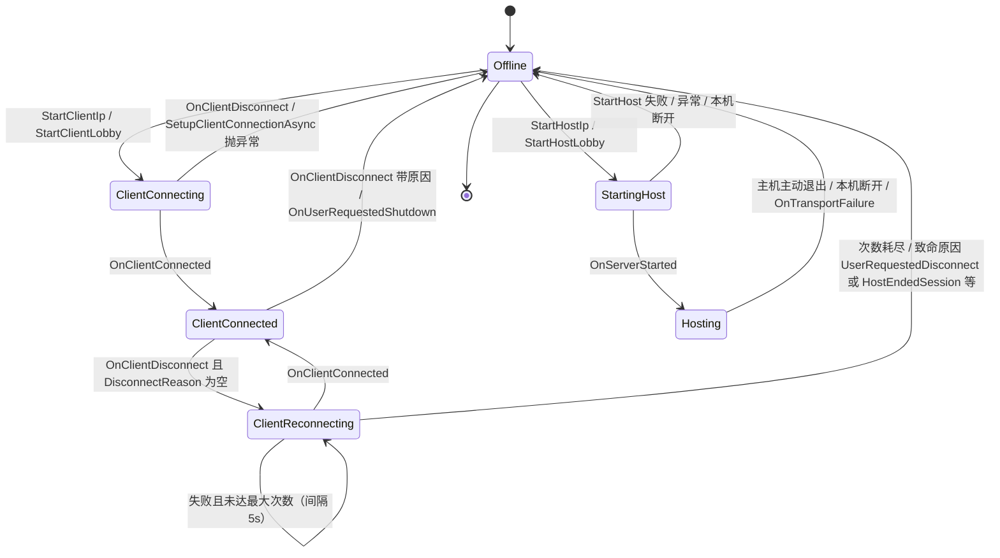

# 联机与连接生命周期技术笔记

> 覆盖范围：`Assets/Scripts/ConnectionManagement/**`、`Infrastructure/**`、`UnityServices/**`、`ApplicationLifecycle/**`、`Utils/**`，共 44 个 `.cs` 文件，已逐行读完。
> 约定：关键位置用 `文件路径:行号` 标注；行号以当前工作区文件为准。

---

## 0. 模块地图与启动链

| 程序集（asmdef） | 职责 | 关键依赖 |
| --- | --- | --- |
| `LoveMe.Mahjong.Infrastructure` | UpdateRunner、PubSub 总线、场景加载/进度、NetworkGuid、ScriptableObject 架构 | Netcode、VContainer、Unity.Collections |
| `LoveMe.Mahjong.ConnectionManagement` | 连接状态机、ConnectionMethod（IP/Relay）、SessionManager | Netcode、Services.Core/Auth/Lobbies/Relay、Unity.Networking.Transport、Infrastructure、UnityServices |
| `LoveMe.Mahjong.UnityServices` | Auth facade、Lobby facade / API / 本地镜像 / 心跳 | Services.Authentication、Services.Lobbies、VContainer、Infrastructure |
| `LoveMe.Mahjong.Utils` | ProfileManager、ClientPrefs、BotCounter、NetworkNameState、MahjongUtils | Netcode、Unity.Collections |
| `LoveMe.Mahjong.ApplicationLifecycle` | 根 LifetimeScope（ApplicationController）、退出消息 | ConnectionManagement、UnityServices、Gameplay |

依赖方向是**单向向下**的：`Gameplay` → `ConnectionManagement` → `UnityServices` / `Infrastructure`；`Gameplay.asmdef` 反向引用 `ConnectionManagement`，而 `ConnectionManagement` 只引用 `Gameplay.Messages` 程序集（见 `Assets/Scripts/ConnectionManagement/LoveMe.Mahjong.ConnectionManagement.asmdef`），所以规则层与联机层之间只有消息契约，没有实现耦合。

启动链：`Assets/Scenes/Startup.unity` 常驻 `NetworkManager` / `ApplicationController` / `UpdateRunner` / `SceneLoaderWrapper` → `ApplicationController.Configure` 注册所有消息通道与单例（`Assets/Scripts/ApplicationLifecycle/ApplicationController.cs:36-62`）→ `Start` 载入 `MainMenu`（同文件 `:64-80`，载入语句在 `:79`）。`Application.wantsToQuit` 拦截「大厅中直接关窗」的场景（`:89-112`）。

---

## 1. 连接状态机

### 1.1 结构：单入口 + 状态转发

`ConnectionManager`（`Assets/Scripts/ConnectionManagement/ConnectionManager.cs:52`）是唯一对外入口，它做三件事：

1. **持有状态**：6 个状态是字段级单例，不是每次 `new`（`:69-74`），`Start` 里用 VContainer 注入它们（`:83-87`），初值为 `Offline`（`:89`）。
2. **事件转发**：把 NGO 的 `OnClientConnectedCallback` / `OnClientDisconnectCallback` / `OnServerStarted` / `ConnectionApprovalCallback` / `OnTransportFailure` 全部转给 `_currentState` 的同名 virtual 方法（`:91-95`、`:106-129`）。
3. **命令转发**：UI 只调用 `StartHostIp` / `StartClientIp` / `StartHostLobby` / `StartClientLobby` / `RequestShutdown`（`:131-154`）。

状态切换集中在 `ChangeState`：`Exit()` → 换引用 → `Enter()`，并打一条日志（`:156-163`）。抽象基类 `ConnectionState` 把 12 个钩子全部定义为空实现（`Assets/Scripts/ConnectionManagement/ConnectionState/ConnectionState.cs:9-38`），子类只覆写关心的几个；`OnlineState` 在其上补了 `DtlsConnType = "dtls"`、`OnUserRequestedShutdown`、`OnTransportFailure` 三个「在线态通用行为」（`.../OnlineState.cs:3-17`）。

| 状态 | 文件:行 | 职责 | 关键副作用 |
| --- | --- | --- | --- |
| Offline | `OfflineState.cs:10` | 空闲/主菜单 | `EndTracking` + `NetworkManager.Shutdown` + 切回 MainMenu（`:18-26`） |
| ClientConnecting | `ClientConnectingState.cs:10` | 设传输层参数后 `StartClient` | 成功后进入 ClientConnected（`:30-34`） |
| ClientConnected | `ClientConnectedState.cs:7` | 稳态在线 | 有 Lobby 时 `BeginTracking`（`:12-18`） |
| ClientReconnecting | `ClientReconnectingState.cs:8` | 协程重试 | 继承 ClientConnecting，复用 `ConnectClientAsync` |
| StartingHost | `StartingHostState.cs:11` | 建 Relay 分配并 `StartHost` | 失败回 Offline（`:59-63`） |
| Hosting | `HostingState.cs:11` | 主机稳态 + 审批 + 掉线记账 | 进场即载入 GameRoom（`:20-30`） |

> 注意继承关系决定了「谁响应传输层故障」：只有 `StartingHost` 与 `Hosting` 继承 `OnlineState`，所以 `OnTransportFailure` 只在主机侧回 Offline；客户端连接期/在线期的失联完全依赖 NGO 的 `OnClientDisconnect` 回调驱动（`ConnectionState.cs:37` 的空实现不会误触发）。

### 1.2 状态迁移图



### 1.3 每次迁移的判定条件

- **Offline → ClientConnecting**：先构造 `ConnectionMethodIp` 或 `ConnectionMethodRelay`，同时把它塞进 `ClientReconnecting` 备用（`OfflineState.cs:30-42`），因此「首次连接」与「重连」共用同一份连接参数对象——这是设计上的关键复用点。
- **ClientConnecting → ClientConnected**：在 `Enter` 里 fire-and-forget 地跑 `ConnectClientAsync`（`ClientConnectingState.cs:23-26`）：`SetupClientConnectionAsync` → `NetworkManager.StartClient()` → `SceneLoaderWrapper.AddOnSceneEventCallback()`（`:56-70`）。成功回调里发布 `ConnectStatus.Success` 再切状态（`:30-34`）。
- **ClientConnecting → Offline**：`StartingClientFailedAsync` 把 `NetworkManager.DisconnectReason` 当 JSON 反序列化成 `ConnectStatus` 发布（`:41-54`）；这就是「服务端拒绝理由如何到达客户端」的通道，服务端在 `HostingState.ApprovalCheck` 里写入 `response.Reason = JsonUtility.ToJson(gameReturnStatus)`（`HostingState.cs:105`）。
- **ClientConnected → ClientReconnecting**：**仅当** `DisconnectReason` 为空时才认为是「网络抖动」并尝试重连；否则按服务端给的枚举直接回 Offline（`ClientConnectedState.cs:22-36`）。这条「空原因=可重试」的隐式约定是全套重连逻辑的基石。
- **ClientReconnecting**：`Enter` 记下 `LobbyCode`（用于判断走 Lobby 重连还是裸 Relay 重连，`ClientReconnectingState.cs:19-24`）；协程先 `Shutdown` 并等待 `ShutdownInProgress` 结束（`:98-100`），再发 `ReconnectMessage` 更新 UI（`:102`）；有 `LobbyCode` 时先 `ReconnectToLobbyAsync` 再连 Relay（`:104-128`），否则直接重连（`:129-134`）。**致命原因白名单**见 `:55-66`。
- **StartingHost → Hosting**：`OnServerStarted` 里发布 Success 并切换（`StartingHostState.cs:65-69`）；Relay 模式的 join code 在 `SetupHostConnectionAsync` 阶段就已写进 Lobby（见 §2）。
- **Hosting → Offline**：本机断开（`HostingState.cs:42-47`）、主动退出时先给所有客户端发 `HostEndedSession` 原因再走 Offline（`:63-75`）、`Exit` 里清空会话（`:32-35`）。

### 1.4 ConnectStatus 语义表

`ConnectStatus`（`ConnectionManager.cs:10-23`）共 11 个值，客户端文案的集中映射在 `Assets/Scripts/Gameplay/UI/ConnectionStatusMessageUIManager.cs:32-68`。服务端判定逻辑在 `HostingState.GetConnectStatus`（`:112-126`）：

| 状态 | 产生位置 | 含义 |
| --- | --- | --- |
| `ServerFull` | `HostingState.cs:114` | `ConnectedClientsIds.Count >= MaxConnectedPlayers - BotCounter.Count`（**Bot 占位**） |
| `IncompatibleBuildType` | `HostingState.cs:119` | `connectionPayload.isDebug != Debug.isDebugBuild` |
| `LoggedInAgain` | `HostingState.cs:124` | 同 playerId 已在线（顶号） |
| `StartHostFailed` / `StartClientFailed` | `StartingHostState.cs:61` / `ClientConnectingState.cs:46` | 本地启动阶段失败 |
| `HostEndedSession` | `HostingState.cs:65` | 主机主动解散 |
| `Reconnecting` / `GenericDisconnect` | `ClientConnectedState.cs:27` / `ClientReconnectingState.cs:73` | 抖动进入重连 / 重连彻底失败 |

审批入口还有一条 DOS 防护：payload 超过 1024 字节直接拒绝（`HostingState.cs:18`、`:81-87`）。

---

## 2. ConnectionMethod：局域网 IP 与 Unity Lobby+Relay

### 2.1 抽象与共用逻辑

`ConnectionMethodBase`（`Assets/Scripts/ConnectionManagement/ConnectionMethod.cs:15-60`）只定义两件事：`SetupHostConnectionAsync` / `SetupClientConnectionAsync`，以及两个工具方法。

- `SetConnectionPayload`（`:36-49`）：把 `ConnectionPayload { playerId, playerName, avatarGuid, isDebug }`（结构定义在 `ConnectionManager.cs:43-50`）用 **JsonUtility** 序列化成字节写进 `NetworkConfig.ConnectionData`。NGO 的 connection approval 就是靠这条「连接数据」传递身份，服务端在 `ApprovalCheck` 里反序列化（`HostingState.cs:89-96`）。
- `GetPlayerId`（`:51-59`）：优先用 UGS 的 `AuthenticationService.PlayerId`；未初始化/未登录时退回 `ClientPrefs.GetGuid() + ProfileManager.Profile`（`Assets/Scripts/Utils/ClientPrefs.cs:42-54`、`ProfileManager.cs:23-31`）。这条 fallback 让**纯局域网不依赖任何云服务**也能有稳定身份与「同机多开」区分。

### 2.2 ConnectionMethodIp（局域网）

`ConnectionMethodIp`（`ConnectionMethod.cs:62-89`）：host 与 client 两边的实现几乎一样——设 payload，然后

```csharp
var utp = (UnityTransport)ConnectionManager.NetworkManager.NetworkConfig.NetworkTransport;
utp.SetConnectionData(_ip, _port);
```

即 `ConnectionMethod.cs:77-78` 与 `:85-86`。host 侧传的是 `0.0.0.0`（监听所有网卡），client 侧传玩家输入的目标 IP；端口在 UI 层固化为 **9988**（`Assets/Scripts/Gameplay/UI/GameStarter/IpGameStarterUIMediator.cs:8-9`，join 时只校验 `IPAddress.TryParse`，`:24-31`）。整个过程**零网络请求、零账号**，完全离线可玩，适合同宿舍/同办公室局域网，也是本项目的单人+Bot 主玩法入口。

### 2.3 ConnectionMethodRelay（Unity Lobby + Relay）

`ConnectionMethodRelay`（`ConnectionMethod.cs:91-145`）依赖 `LobbyServiceFacade` 与 `LocalLobby` 两个注入对象。

**Host 侧**（`:125-144`）三步：
1. `RelayService.Instance.CreateAllocationAsync(MaxConnectedPlayers, region: null)`（`:131`）建 Relay 分配，并向 Relay 换 join code（`:132`）。
2. 把 join code 写进 `LocalLobby.RelayJoinCode`（`:137`），再 `UpdateLobbyDataAsync` 推到云端 Lobby 的 `Data["RelayJoinCode"]`（`:139`，数据组装见 `LocalLobby.cs:344-348`），同时 `UpdatePlayerRelayInfoAsync` 把 allocationId/connectionInfo 写进玩家数据（`:140`）。
3. `utp.SetRelayServerData(new RelayServerData(hostAllocation, OnlineState.DtlsConnType))`（`:142-143`）。

**Client 侧**（`:103-123`）：先断言 `CurrentUnityLobby != null`（`:109-112`），再 `RelayService.Instance.JoinAllocationAsync(_localLobby.RelayJoinCode)`（`:116`），最后同样 `SetRelayServerData`（`:121-122`）。也就是说 **Lobby 只负责「找到房间 + 交换 join code」，真正传输走 Relay**，这解释了为什么 join code 必须由 host 写进 Lobby 数据、client 从自己的 LocalLobby 镜像里读。

### 2.4 两种模式对比

| 维度 | 局域网 IP | Unity Lobby + Relay |
| --- | --- | --- |
| 依赖 | 无（纯 UTP/UDP） | UGS：Auth + Lobby + Relay 三个云服务 |
| 地址发现 | 手输 IPv4，端口固定 9988 | Lobby 列表 / 大厅码 / QuickJoin，join code 自动分发 |
| 传输路径 | 直连，同网段；跨网段需端口转发 | 经 Unity Relay 中继，NAT 穿透由 Relay 负责 |
| 最大连接数 | NGO 审批上限 4（减 Bot 占位） | Relay 分配 `MaxConnectedPlayers` 个槽（`ConnectionMethod.cs:131`）+ NGO 审批上限 4，两层口径不完全一致 |
| 身份 | PlayerPrefs GUID + Profile 字符串 | UGS PlayerId（匿名登录），失败才 fallback |
| 断线重连 | `ClientReconnectingState` 直接重连（`:129-134`） | 先 `ReconnectToLobbyAsync` 再连 Relay（`:104-128`），依赖 Lobby 的「断线保留期」 |
| 进场链路 | Offline → ClientConnecting/StartingHost → … | 同上，但多一步 Lobby 创建/加入（`LobbyGameStarterUIMediator.cs:27-55`、`:60-109`） |
| 适用场景 | 单人+Bot、局域网朋友局、离线调试 | 异地联机、需要房间列表/公开匹配 |

> 结论：代码里**只有两个具体策略类**（`ConnectionMethodIp` / `ConnectionMethodRelay`），并不存在独立的「Direct」实现；「Lobby」与「Relay」是同一个策略，Lobby 是发现层、Relay 是传输层。

---

## 3. SessionManager 与 SessionPlayerData

`SessionManager<T>`（`Assets/Scripts/ConnectionManagement/SessionManager.cs:13`）是一个泛型、**静态单例**的会话表（`:31`），维护两张字典：playerId → T、clientId → playerId（`:17-19`）。`T` 约束为 `struct, ISessionPlayerData`（`:7-11`）。本项目实例化只有 `SessionManager<SessionPlayerData>`。

`SessionPlayerData`（`SessionPlayerData.cs:5-25`）字段：`PlayerName / SeatIndex（初始 byte.MaxValue 表示未占座）/ AvatarNetworkGuid / Gender / IsConnected / ClientId`；`Gender` 是 `byte` 枚举（`:27-31`）。座位号存在会话里而不是节点上，是「断线重连能回到原座位」的数据前提。

核心行为：

- `SetupConnectingPlayerSessionData`（`SessionManager.cs:129-163`）在审批通过时调用（`HostingState.cs:95-96`、`StartingHostState.cs:81-82`）。它先查重（同 playerId 且 `IsConnected` → 拒绝，`:134-138`），再判断「同 playerId 但已断开」→ 视为**重连**，沿用旧数据结构只更新 `ClientId`（`:152-158`）。这就是掉线玩家数据不被销毁的实现。
- `DisconnectClient`（`:33-59`）行为由 `m_HasSessionStarted` 决定：**比赛进行中**只把 `IsConnected` 置 false 并保留数据（`:35-46`）；**非比赛中**直接删两张表（`:47-58`）。开关由规则层驱动——`ServerGameRoomState.cs:294-302` 在 `m_Game.HasStarted` 变化时调用 `StartSession` / `EndSession`。
- `OnServerEnded`（`:117-122`）在 `HostingState.Exit` 中清空（`HostingState.cs:34`），保证主机回主菜单后不留脏数据。
- `IsDuplicateConnection`（`:124-127`）被审批层用于判定 `LoggedInAgain`。

---

## 4. Lobby 子系统

分四层，职责很清晰：

**(1) 纯 API 薄封装 —— LobbyAPIInterface**（`Assets/Scripts/UnityServices/Lobbies/LobbyAPIInterface.cs:8`）。只做 SDK 转调与查询参数：过滤「有空位」+ 按创建时间倒序（`:17-20`），最多 16 条（`:10`）；异常处理只有一处「PlayerNotFound 视为成功」（`:73-84`）。

**(2) 本地镜像 —— LocalLobby / LocalLobbyUser**。`LocalLobby`（`LocalLobby.cs:54`）用 `LobbyData` 结构（`:10-38`）装 6 个字段，每个 setter 都做「值未变则直接 return，变了才写 `m_lastChanged` 位掩码 + 触发 `Changed`」（例：`:73-87`）。`LobbyMembers` 是 `[Flags]` 枚举（`:40-51`），用增量位掩码告诉 UI「到底哪一项变了」，避免整面板刷新。`LocalLobbyUser` 同构（`LocalLobbyUser.cs:8-153`，`UserMembers` 在 `:41-49`）。

远端数据落地走 `ApplyRemoteData`（`:298-342`）→ `CopyDataFrom`（`:213-259`）→ `DetectChanges`（`:261-296`），对玩家做增删比对并复用已有 `LocalLobbyUser` 实例（`:323-327`），保证引用不失效。

**(3) 生命周期与限流 —— LobbyServiceFacade**（`LobbyServiceFacade.cs:15`）。它实现 `IStartable`，在 `Start` 里创建**子 LifetimeScope** 注册心跳与 API 两个单例（`:40-56`），并按官方限流文档为 4 类调用各配一个 `RateLimitCooldown`：query 1s / join 3s / quickJoin 10s / host 3s（`:52-55`）。所有对外方法都先 `CanCall` 再发请求，命中 `LobbyExceptionReason.RateLimited` 时 `PutOnCooldown`（如 `:119-143`）。

轮询在 `BeginTracking` 时挂到 `UpdateRunner`，**周期 5s**（`:70-79`）；`UpdateLobby`（`:308-347`）拉取 Lobby 并 `ApplyRemoteData`，非 host 时挨个检查「host 是否还在玩家列表」，掉线则发 `UnityServiceErrorMessage("Host left the lobby")` 并 `EndTracking`（`:322-334`）。`EndTracking`（`:81-115`）做对称清理：host 删房、客机退房、重置本地镜像、退订。

**(4) 心跳 —— JoinedLobbyContentHeartbeat**（`JoinedLobbyContentHeartbeat.cs:7`，注意命名空间是 `...Lobbies.Lobbies`，重命名遗留）。`BeginTracking` 以 **1.5s** 周期订阅（`:24-29`）；每次 tick：host 先 `DoLobbyHeartbeat`（内部 8s 一次 ping，`LobbyServiceFacade.cs:24`、`:349-368`），若 `_shouldPushData` 则分别推送 Lobby 数据（仅 host）与玩家数据，并用 `_awaitingQueryCount` 做**重入闸门**防止并发请求叠加（`:48-75`）。`OnLocalLobbyChanged` 把 `Changed` 事件变成「置脏标记」，并房号为空时自动 `EndTracking`（`:38-46`）。

---

## 5. Relay 与 Netcode/UTP 配置

- 传输组件是 `UnityTransport`，代码里**4 处**强转取用（`ConnectionMethod.cs:77/85/121/142`），配置全部通过 `SetConnectionData` 或 `SetRelayServerData` 在运行期覆盖，不依赖场景里的静态值。
- Relay 加密用 DTLS：`OnlineState.DtlsConnType = "dtls"`（`OnlineState.cs:5`），两侧都传（`ConnectionMethod.cs:122/143`）。
- 预置参数在 `Assets/Prefabs/NetworkManager.prefab`：`ConnectionApproval: 1`（`:67`）、`EnableSceneManagement: 1`（`:72`）、传输层 `m_ProtocolType: 0`（UDP）、`m_MaxPayloadSize: 6144`、`m_HeartbeatTimeoutMS: 500`、`m_DisconnectTimeoutMS: 10000`、默认 `Address 127.0.0.1 / Port 7788 / ServerListenAddress 0.0.0.0`（`:92-101`）。**注意 prefab 端口 7788 与 IP 模式实际使用的 9988 不一致**，运行期总会被 `SetConnectionData` 覆盖，属于容易误配的隐患。
- NGO 事件被 `ConnectionManager` 全量接管（§1.1），场景同步开关由 `NetworkConfig.EnableSceneManagement` 决定，`SceneLoaderWrapper` 会自己判空（`SceneLoaderWrapper.cs:13`）。

---

## 6. Auth 与 Profile

`AuthenticationServiceFacade`（`Assets/Scripts/UnityServices/Auth/AuthenticationServiceFacade.cs:10`）提供三个方法：

- `InitializeAndSignInAsync`（`:14-31`）：`UnityServices.InitializeAsync(options)` → 未登录则 `SignInAnonymouslyAsync`，异常封装成 `UnityServiceErrorMessage` 后**继续 throw**。
- `SwitchProfileAndReSignInAsync`（`:33-51`）：SignOut → `SwitchProfile` → 重新匿名登录。
- `EnsurePlayerIsAuthorized`（`:53-79`）：入口级「确保可用」，**认证异常不 rethrow**（视为已处理失败返回 false），其他异常照旧上抛——这个区分很实用，UI 只关心能否进大厅。

Profile 由 `ProfileManager` 管理（`Assets/Scripts/Utils/ProfileManager.cs:13`）：支持命令行 `-AuthProfile`（`:58-69`），编辑器下用 `Application.dataPath` 的 MD5 生成稳定 profile（`:71-74`），打包后才落盘到 `ClientPrefs` 的 CSV 列表（`:84-101`）。主菜单进入时统一初始化（`Assets/Scripts/Gameplay/GameState/ClientMainMenuState.cs:91-110`），大厅相关按钮在登录成功前不可点（`:112-118`）。

---

## 7. 基础设施

**UpdateRunner**（`Infrastructure/UpdateRunner.cs:9`）：全项目唯一的 `Update` 分发点。`Subscribe(Action<float>, period)` 有三个防御：空委托、闭包（`Target == null`）、编译器生成的匿名方法一律拒绝并报错（`:36-46`），因为「无法被退订」；订阅/退订先进 `_pendingHandlers` 队列，在 `Update` 开头统一生效，避免遍历中修改集合（`:50-67`、`:72-75`）；每帧按 `NextCallTime` 做**周期调度**，回调参数是「距上次调用的真实间隔」（`:77-87`）。Lobby 的 5s 轮询、心跳的 1.5s tick 都挂在这里。

**PubSub 总线**：`IPublisher<T>` / `ISubscriber<T>` / `IMessageChannel<T>`（`PubSub/IMessageChannel.cs:5-27`），`IBufferedMessageChannel<T>` 额外带 `HasBufferedMessage/BufferedMessage`（`:22-27`）。`MessageChannel<T>` 的实现在 `Publish` 开头先应用 pending 的订阅/退订（`MessageChannel.cs:24-43`），因此「在回调里退订自己」是安全的；`Subscribe` 断言禁止重复订阅并返回 `IDisposable`（`:45-63`）。`BufferedMessageChannel<T>` 在订阅时立刻补发最后一条消息（`BufferedMessageChannel.cs:14-24`），用于「UI 打开晚于数据到达」的大厅列表。`NetworkedMessageChannel<T>`（`NetworkedMessageChannel.cs:8`）要求 `unmanaged, INetworkSerializeByMemcpy`，**只有 server 能 Publish**（`:56-68`），内部用 `CustomMessagingManager` 的 NamedMessage 广播（`:70-81`），handler 只在客户端注册（`:47-54`）。`DisposableSubscription<T>` 保证退订幂等且通道已 Dispose 时不抛（`DisposableSubscription.cs:17-31`）；`DisposableGroup` 做批量释放（`DisposableGroup.cs:10-23`）。

通道注册一览（`ApplicationController.cs:50-57`）：`QuitApplicationMessage` / `UnityServiceErrorMessage` / `ConnectStatus` / `ReconnectMessage` 是本地 `MessageChannel`；`LobbyListFetchedMessage` 是 `BufferedMessageChannel`；`ConnectionEventMessage`（`ConnectionManager.cs:37-41`）是**跨网络**的 `NetworkedMessageChannel`，用 memcpy 结构体承载 `ConnectStatus + FixedPlayerName`。

**关键数据类型**：`NetworkGuid`（`NetworkGuid.cs:6-16`）把 16 字节 Guid 拆成两个 ulong 走 `INetworkSerializable`，配 `Guid.ToNetworkGuid()` / `ToGuid()` 扩展（`:20-36`）；`NetworkNameState` + `FixedPlayerName` 用 `FixedString32Bytes` 传名字（`Utils/NetworkNameState.cs:7-30`）；`RuntimeCollection<T>` 是带 `ItemAdded` / `ItemRemoved` 事件的 ScriptableObject 列表（`ScriptableObjectArchitecture/RuntimeCollection.cs:7-32`）；`GuidScriptableObject` 在 `OnValidate` 里自生成 Guid（`GuidScriptableObject.cs:17-23`）；`IdAutoGenerationScriptableObject` 用 `GlobalObjectId` 的 HashCode 作稳定 uint id，并自带 `[ReadOnly]` 绘制器（`IdAutoGenerationScriptableObject.cs:19-52`）。

---

## 8. 场景加载与 Loading 进度

`SceneLoaderWrapper`（`Infrastructure/Net/SceneLoaderWrapper.cs:7`）是 NetworkBehaviour 单例（`:17-28`），对外只有一个 `LoadScene(sceneName, useNetworkSceneManager)`：

- 走网络场景管理时**只有 server 能发起** `NetworkManager.SceneManager.LoadScene`（`:57-68`）；
- 不走网络时用 `SceneManager.LoadSceneAsync` 并顺手喂本地加载屏（`:69-77`）。
- 客户端在 `SceneEventType.Load` 启动/更新加载屏、`LoadEventCompleted` 收起（`:88-114`）；`Synchronize` 阶段先卸载其他 additive 场景规避 MTT-3363（`:115-126`，注释原文保留）；`SynchronizeComplete` 时由 server 定向 `ClientRpc` 才关加载屏，确保「服务端生成玩家」仍在遮罩之后（`:127-133`）。

`LoadingProgressManager`（`LoadingProgressManager.cs:8`）在 server 为每个 client 生成一个 `NetworkedLoadingProgressTracker`（`AddTracker:97-107`），进度本体是 `NetworkVariable<float>`，读权限 Everyone、写权限 Owner（`NetworkedLoadingProgressTracker.cs:7`）；本地进度优先读写自己的 tracker，未 spawn 时退回本地字段（`:30-45`）。`ClientLoadingScreen`（`ClientLoadingScreen.cs:12`）据此为每个远端玩家维护一根进度条（`OnProgressTrackersUpdated:93-119`），淡出用协程（`:225-239`）。`NetcodeHooks` 只是把 `OnNetworkSpawn/Despawn` 暴露成 C# 事件（`NetcodeHooks.cs:6-23`），供非 NetworkBehaviour 的视图层订阅。

---

## 9. 断线重连与错误处理

**重连策略**：`_nbReconnectAttempts = 2`（`ConnectionManager.cs:55`）、固定间隔 `TimeBetweenAttempts = 5s`（`ClientReconnectingState.cs:13`），代码注释明确承认「可以换指数退避」（`:87-90`）。每次尝试前强制 `Shutdown` 并等 `ShutdownInProgress` 归零（`:98-100`），然后按「有无 `LobbyCode`」分两路。UI 进度靠 `ReconnectMessage(CurrentAttempt, MaxAttempt)`（`ConnectionManager.cs:25-35`）；`Exit` 时发 `(Max, Max)` 作为「关闭弹窗」的约定信号（`ClientReconnectingState.cs:34`），消费端据此判断（`ConnectionStatusMessageUIManager.cs:70-84`）。

**Lobby 重连语义**：Relay 断线后 Lobby 服务只是把玩家标记为 disconnected，不会立刻移除，玩家可在 dashboard 配置的保留窗口内重连（这是 `ClientReconnectingState.cs:106-110` 注释里引用的官方行为），所以 Lobby 模式下重连成功率高，但也意味着「真掉线」要等窗口过期才被踢。

**错误通道**：`UnityServiceErrorMessage`（`UnityServices/Infrastructure/Messages/UnityServiceErrorMessage.cs:5-25`）携带 `Title/Message/AffectedService/OriginalException`，通过本地 `MessageChannel` 汇到 UI；`RateLimitCooldown`（`RateLimitCooldown.cs:5-24`）用 `Time.unscaledTime` 做冷却（`:18`），保证限流期间不打断游戏节奏（不受 `timeScale` 影响）。

**主机退出**：`HostingState.OnUserRequestedShutdown` 逐个 `DisconnectClient(id, JsonUtility.ToJson(HostEndedSession))`（`:63-75`），客户端在 `ClientConnectedState` 收到非空 reason 就回 Offline 并弹「主机已结束游戏」。

---

## 10. Boss Room 遗留 vs 本项目自定义

判断依据：命名空间已整体改成 `LoveMe.Mahjong.*`，但**类名、字段命名（`m_` 前缀与无前缀混用）、注释原文、以及 `...Lobbies.Lobbies` 这种重命名后重复的命名空间**，都能反推出原始来源。

**基本原样保留（Boss Room 体系）**：
- `Infrastructure/` 全部：`UpdateRunner`、`PubSub/` 五个文件、`Net/ClientLoadingScreen`、`LoadingProgressManager`、`NetcodeHooks`、`NetworkedLoadingProgressTracker`、`SceneLoaderWrapper`（含 MTT-3363 注释）、`NetworkGuid`、`DisposableGroup`、`ScriptableObjectArchitecture/` 三个基类。
- `ConnectionManagement/ConnectionState/` 的状态机骨架与 `OnlineState.DtlsConnType`、`ClientReconnectingState` 的重连协程、`SessionManager<T>` 的两张字典与重连复用逻辑。
- `UnityServices/Lobbies/` 的 `LocalLobby/LocalLobbyUser/LobbyServiceFacade/LobbyAPIInterface/JoinedLobbyContentHeartbeat`，以及 `RateLimitCooldown`、`UnityServiceErrorMessage`、`AuthenticationServiceFacade`、`ProfileManager`、`ClientPrefs`。

**本项目改写/新增**：
- `ConnectionManager.MaxConnectedPlayers => MahjongUtils.MaxConnectedPlayers`（= 4，`ConnectionManager.cs:57`、`Utils/MahjongUtils.cs:7`），Boss Room 是 8；`MahjongUtils.GetRelativeSeatIndex` 用 4 取模（`:9-12`）。
- `HostingState.GetConnectStatus` 引入 `BotCounter` 扣减座位（`HostingState.cs:114`，`BotCounter` 定义在 `Utils/BotCounter.cs:3`，由 `ServerGameRoomState` 增删）——**Bot 与真人共享 4 个座位**。
- `SessionPlayerData` 增加 `SeatIndex / Gender / AvatarNetworkGuid`（`SessionPlayerData.cs:7-19`），Boss Room 对应结构是 PlayerNumber 一类的字段。
- `LocalLobby` 被大幅**裁剪**：只剩 LobbyId/Code/RelayJoinCode/Name/Private/MaxPlayerCount 6 项（`LocalLobby.cs:10-38`），去掉了 Boss Room 的关卡/难度/状态等一堆字段；push 到云端的也只有 `RelayJoinCode` 一项（`:344-348`）。
- `LocalLobbyUser` 只剩 IsHost/DisplayName/Id/AvatarGuid（`LocalLobbyUser.cs:20-34`）。
- `ConnectionPayload` 增加 `avatarGuid`（`ConnectionManager.cs:43-50`）；`ConnectionEventMessage` 用 `FixedPlayerName` 而非裸字符串（`:37-41`）。
- `BotCounter`、`MahjongUtils`、`NetworkNameState`（玩家名网络同步）为本项目新增；`ConnectionStatusMessageUIManager` 的文案全部中文化（`ConnectionStatusMessageUIManager.cs:40-62`）。
- 连接入口场景拆成 `IpGameStarter` / `LobbyGameStarter` 两个（`Assets/Scenes/` 下同名场景），对应本项目的「局域网 / 在线」双模式。

---

## 11. 设计亮点与可改进点

### 亮点（建议直接写进架构文档）

1. **状态机 + 策略双正交**：状态（Offline/Connecting/Hosting/…）与连接方式（IP/Relay）互不耦合——状态只持有 `ConnectionMethodBase` 抽象（`ConnectionState.cs:25-31` → `ClientConnectingState.Configure`），新增一种传输方式只需再写一个 `ConnectionMethodBase` 子类，状态机与 UI 完全不用改。同时「首次连接」与「重连」复用同一个 method 实例（`OfflineState.cs:30-42`），天然避免重连参数漂移。
2. **三层 Lobby 数据所有权**：远程 `Lobby` ↔ 本地镜像 `LocalLobby/LocalLobbyUser` ↔ 纯 API 封装 `LobbyAPIInterface`，中间用**位掩码增量**（`LobbyMembers`/`UserMembers`）和 `Changed` 事件把「哪些字段变了」传递给表现层，再用 `UpdateRunner` 的周期调度 + `RateLimitCooldown` 把云调用节流成固定频率。这是 Boss Room 里最值得抄的一块。
3. **「比赛中断线不删档」的会话模型**：`SessionManager` 的保留/删除由规则层的 `StartSession/EndSession` 驱动（`ServerGameRoomState.cs:294-302`），配合 client 侧两级重连（Lobby reconnect → Relay connect），实现「掉线保留座位、可回原座」。联机层因此不需要理解麻将规则，规则层也不需要理解网络。

### 可改进点

1. **Relay 主机侧疑似 bug**：`_lobbyServiceFacade.UpdatePlayerRelayInfoAsync(hostAllocation.AllocationIdBytes.ToString(), joinCode)`（`ConnectionMethod.cs:140`）对 `byte[]` 调 `ToString()` 会得到 `System.Byte[]`，写进 Lobby 的 allocationId 实际无意义；应改用 `AllocationId.ToString()` 或 base64。
2. **`LocalLobby.DetectChanges` 位掩码写错**：`RelayJoinCode` 变化时置的是 `LobbyMembers.Private`（`LocalLobby.cs:285-288`），会导致「join code 更新」被误报成「私密性变化」。
3. **`ClientLoadingScreen` 有订阅泄漏**：`OnProgressTrackersUpdated` 移除玩家时调用 `RemoveOtherPlayerProgressBar(clientId)` 未传 tracker（`ClientLoadingScreen.cs:105-108`），而反订阅只在 tracker != null 分支执行（`:202-207`），`Progress.OnValueChanged` 会残留。
4. **状态对象是共享单例 + `Configure()` 可变**：`ConnectionManager` 的 6 个状态字段是 readonly 单例（`:69-74`），`Configure` 直接改内部字段再返回 `this`。当前调用是串行的所以安全，但一旦有并发/重入（例如重连中再点加入），就会出现「状态与 method 错配」。建议 Configure 时附带版本号或改为传参构造。
5. **`OnTransportFailure` 覆盖不全**：只有 `OnlineState` 子类响应（`OnlineState.cs:13-16`），`ClientConnecting/ClientConnected` 不处理传输层故障，只能等 NGO 的 disconnect 回调，弱网下可能出现较长的「无 UI 反馈」窗口。
6. **重连参数硬编码**：次数 2、间隔 5s 固定（`ConnectionManager.cs:55`、`ClientReconnectingState.cs:13`），无退避、无抖动；注释也承认可以换指数退避（`:87-90`）。
7. **`ClientConnecting` 失败路径会 rethrow**（`ClientConnectingState.cs:71-77`）：已经切回 Offline 并发布了错误，再 throw 会变成未观测的 Task 异常，日志噪音。
8. **两套容量口径**：Relay 分配按 `MaxConnectedPlayers=4` 建（`ConnectionMethod.cs:131`，Relay 的 maxConnections 通常不含 host），而 NGO 审批又按「总数 4 + Bot 占位」限制，极端情况下第 5 个连接能连上 Relay 才被审批拒绝（`HostingState.cs:114`）。建议统一成「客户端槽位数」再 +1。
9. **`OfflineState.Enter` 无条件 `NetworkManager.Shutdown()`**（`OfflineState.cs:21`）：从 Offline → Offline（如在主菜单重复失败）会重复走关闭流程，可在 Shutdown 前加 `IsListening/ShutdownInProgress` 判断。
10. **`UpdateRunner` 的反射式防御是双刃剑**（`UpdateRunner.cs:36-46`）：禁止匿名/局部函数订阅提升了安全性，但也把「lambda + 捕获」这种最自然的写法彻底挡掉了，新人容易反复踩。
11. **无鉴权的 playerId**：`ConnectionPayload.playerId` 由客户端自报（`ConnectionMethod.cs:36-49`），服务端只校验长度与重复，localhost 局域网可信，但公网 Relay 场景下可被伪造顶号/抢座。

---

## 12. 速查：目录 → 关键类 → 亮点

| 目录 | 关键类 | 一句话 |
| --- | --- | --- |
| ConnectionManagement | ConnectionManager / 6 个 ConnectionState / ConnectionMethodBase | 事件转发 + 状态模式 + 连接策略 |
| ConnectionManagement | SessionManager / SessionPlayerData | 座位与会话，比赛中断线不删档 |
| UnityServices/Lobbies | LocalLobby / LobbyServiceFacade / LobbyAPIInterface / JoinedLobbyContentHeartbeat | 本地镜像 + 限流 + 心跳 |
| UnityServices/Auth | AuthenticationServiceFacade | 匿名登录封装 |
| Infrastructure | UpdateRunner / PubSub / Net | 统一时序 + 解耦总线 + 加载进度 |
| ApplicationLifecycle | ApplicationController | 唯一根 scope，注册所有通道 |
| Utils | ProfileManager / ClientPrefs / BotCounter / NetworkNameState | 身份、偏好、Bot 座位、名字同步 |
