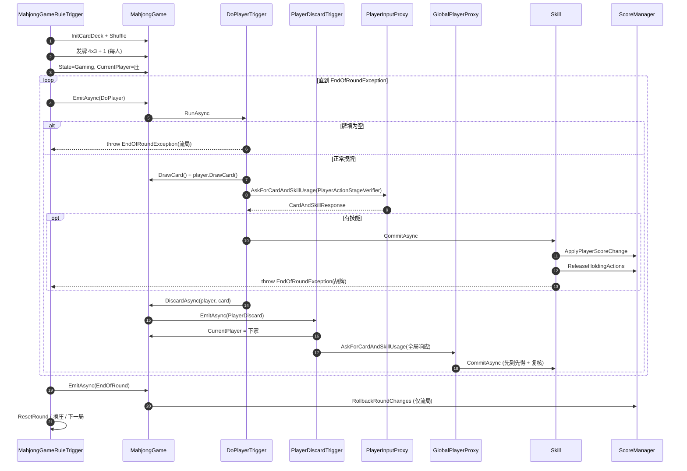
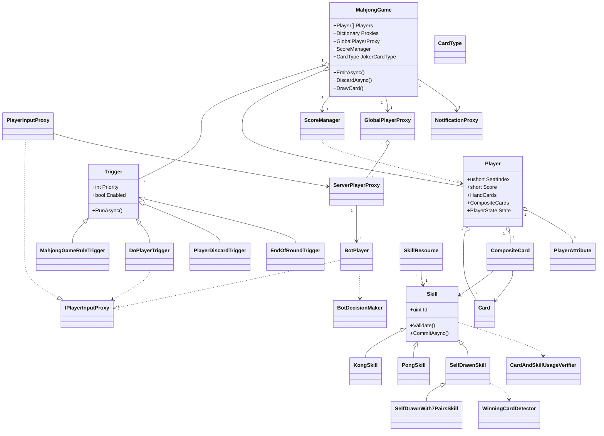

# 规则引擎与算法模块技术笔记（GameRule + Algorithm）

> 范围：`Assets/Scripts/Gameplay/GameRule/**`（30 个 .cs）与 `Assets/Scripts/Gameplay/Algorithm/**`（4 个 .cs），共 40 文件 / 3162 行。
> 另为讲清调用链，引用了约 1200 行强相关代码：`GameplayObjects/Algorithm/*`、`RuntimeDataContainers/GameDataSource.cs`、`Configuration/SkillResource.cs`、`GameplayObjects/Player/{ServerPlayer,PlayerRegistry}.cs`、`GameState/{NetworkGameState,ServerGameRoomState}.cs`、`Serialization/CustomSerializationRegister.cs`。
> 全部结论基于源码实读，行号对应当前工作区版本。

---

## 0. 一句话架构

规则层是一套**纯 C#（除少数 MonoBehaviour 入口外不依赖 UnityEngine）的服务端权威状态机**：`MahjongGame` 持有牌墙、玩家、触发器表与计分器；玩法流程被拆成 4 个 `Trigger`；玩家输入通过 `IPlayerInputProxy` 抽象（真人走 Netcode ServerRpc，Bot 走 `BotPlayer`），服务端状态通过 `ServerPlayerProxy` 手工搬运到 `NetworkVariable/NetworkList`，表现层通过 `NotificationProxy` 的 ClientRpc 单向通知。

---

## 1. 牌模型（Cards）

### 1.1 两级模型：Card 是实例，CardType 是种类

| 类型 | 文件:行 | 结构 |
|---|---|---|
| `SuitType` | `Cards/SuitType.cs:3` | `enum : byte`，值 `Unknown/Character/Dot/Bamboo/Wind/Dragon`（万/筒/条/风/箭） |
| `CardType` | `Cards/CardType.cs:5` | `Id(ushort)` + `Suit(SuitType)` + `Rank(ushort)`，不可变；`==` 只比较 `Id`（`:24`），`GetHashCode` 同理 |
| `Card` | `Cards/Card.cs:5` | `Id(ushort)` + `Type(CardType)`，不可变；`==` 只比 `Id`（`:21`） |

哨兵值贯穿全网：`Card.UnknownCardId = 0`（`Card.cs:7`，占位"未知牌"，牌墙构建时被 Skip 掉）、`Card.NullCardId = ushort.MaxValue`（`:9`，表示 null，用于自定义序列化）；`CardType` 同构（`CardType.cs:7,9`），`Skill.NullSkillId = ushort.MaxValue`（`Skill.cs:16`）。

**编码方式**：`Card.Id` 是全局 1..N 的稠密整数，由 `GameDataSource.BuildCardSet()`（`GameDataSource.cs:67`）按 `CardTypeDefinition` 顺序为每种牌生成 4 张（`MaximumForEachCardType = 4`，`:33`）。因此：
- 网络/存档只传 `ushort cardId`，接收端用 `GameDataSource.Instance.GetCard(id)` 还原为对象（数组下标查找，`:102`）；
- `CardType.Id` 在编辑期由 `GameDataSource.OnValidate()`（`:200`）强制重排为数组下标，等价于"牌种类枚举"；
- `Card` 与 `CardType` 都是引用类型但语义为值，靠 `Id` 相等性做字典键/集合去重。

### 1.2 CompositeCard：副露（碰/杠）牌面

`Cards/CompositeCard.cs:7` 只有 4 个字段：

```csharp
public Skill Skill;              // 组成它的技能（碰/杠/...）
public List<Card> SubCards;      // 2~4 张具体牌
public bool Opened = true;       // 明/暗（暗杠 = false）
public Player Target;            // 被碰/被杠的对象（自摸类为 null）
```

它是**运行期富对象**，可以直接挂 `Player` 引用；跨网传输则换成下面这个扁平结构。

### 1.3 CompositeCardMessage：网络/存储扁平化

`Cards/CompositeCardMessage.cs:8` 是 `unsafe struct`，实现 `INetworkSerializable`：

```csharp
public const int MaxCardsLength = 4;   // :10
public uint SkillId;                    // :12
public byte CardCount;                  // :14
public fixed ushort Cards[4];           // :16  栈上定长数组，零 GC
public bool Opened;                     // :18
public ushort TargetPlayerSeatIndex;    // :20  ushort.MaxValue = 无目标
```

- `NetworkSerialize`（`:36`）把 `fixed ushort[4]` 转成 `Span<ushort>` 后逐元素序列化，定长 4 张保证包大小恒定（碰=3 张、杠=4 张，空位补 0）。
- `Parse(CompositeCard)`（`:115`）与 `ToCard()`（`:94`）是双向适配器：前者把 `Skill.Id`、`SubCards[i].Id`、`Target.SeatIndex` 打平；后者用 `GameDataSource.GetSkill` 和 `PlayerRegistry.Instance.GetPlayer` 还原引用。**注意 `ToCard()` 会拷贝 `Skill` 单例与 `Player` 单例，因此反序列化依赖全局注册表已就绪。**
- 实现了 `IEquatable`（`:52`）与手写 `GetHashCode`（`:72`），供 `NetworkList` 脏检查使用。

---

## 2. 玩家抽象（Players）

### 2.1 `Player`：领域模型（`Players/Player.cs:12`）

```
SeatIndex(ushort, 只读)     HandCards(ObservableCollection<Card>)      ExposedHandCards
Score / IsBanker / State(PlayerState) / ResponseState / WinningCard / LastCardDrawn
CompositeCards / DiscardCards / Attributes(Dictionary<PlayerAttribute,bool>)
```

- 继承 `INotifyPropertyChanged`，用 `SetField<T>`（`:85`）统一发通知；`ServerPlayerProxy` 正是订阅 `PropertyChanged` 把 Score/IsBanker/State/ResponseState/WinningCard 五项写到 `NetworkVariable`。
- `HandCards` 用 `ObservableCollection` 是为了让代理层订阅 `CollectionChanged` 做增量同步。
- `DrawCard(card, jokerCardType)`（`:93`）插入时调 `CalculateCardIndex`（`:123`）按 `Card.Id` 排序，并把**鬼牌（joker）统一排在最后**（`card.Type == joker` 时插到第一张非鬼牌前）。这样手牌天然有序，UI/算法都省一次排序。
- `Reset()`（`:149`）是空实现 + TODO —— 重置逻辑实际写在 `MahjongGame.ResetGame/ResetRound`（`MahjongGame.cs:233/216`）。
- 尾部两个静态字段是"全局牌型属性"的声明：`Player.Kong`（`:154`）、`Player.TwelveCardsConceded`（`:155`）。

### 2.2 `PlayerAttribute`：可自动重置的标量开关（`PlayerAttribute.cs:5`）

这是一个"**类型安全 + 每玩家一实例**"的绕过方案：静态 `Register(name, autoReset)`（`:37`）拿全局单例键；索引器 `this[Player key]`（`:17`）第一次访问时给该玩家克隆一份并塞进 `Player.AssociatedPlayerAttributes`。因此 `source[Player.Kong[target]] = true` 语义是"在 source 身上记录：他杠了 target"。

`MahjongGame.CurrentPlayer` 的 setter（`MahjongGame.cs:57`）在换人时遍历上一玩家的属性，凡 `AutoReset == true` 的全部置回 false —— 这是"回合级状态自动过期"的实现（`TwelveCardsConceded` 显式传 `false` 表示跨回合保留）。

### 2.3 `PlayerResponseState`：等待响应的上下文（`PlayerResponseState.cs:9`）

```csharp
struct PlayerResponseState : INetworkSerializable, IEquatable
{ CardAndSkillUsageVerifier Verifier; Player Target; Card Card; }
```

它是**服务端下发给客户端的"你在等什么"**：客户端 `MainPlayerView`（`MainPlayerView.cs:49`）拿到它，用其中 `Verifier` 先在本地预校验（`:56-69`），通过才发 ServerRpc。`NetworkSerialize`（`:19`）手写三连 `WriteValueSafe`，依赖自定义适配器把对象转成 Id；`Empty`（`:11`）是哨兵。

### 2.4 输入抽象：`IPlayerInputProxy` / `PlayerInputProxy` / `BotPlayer`

- `IPlayerInputProxy`（`IPlayerInputProxy.cs:9`）只有一个方法：`UniTask<CardAndSkillResponse> AskForCardAndSkillUsageAsync(verifier, args, ct)`；`CardAndSkillResponse`（`:14`）是 `{IsSuccess, Card, Skill}` 的结果结构。**这是规则层唯一与"人"耦合的端口**。
- `PlayerInputProxy`（`PlayerInputProxy.cs:11`）是唯一的实现，核心流程（`:20-111`）：
  1. **离线等待**（`:33-50`）：若 `Connection == null`，先给该玩家播 2 分钟掉线倒计时（`NotifyStartIndicatorTimer`），`UniTask.WaitUntil(() => Connection != null)`；超时则返回失败。
  2. **挂响应回调**（`:54-74`）：订阅 `ServerPlayerProxy.ResponseCardAndSkillUsage`，超时 = `game.Timeout + 2` 秒（`:63`，+2 是网络/渲染余量）。
  3. **写网络状态**（`:75-78`）：`HostPlayer.ResponseState = ...`（→ NetworkVariable）同时 `game.ResponseState = {Type=Player, SeatIndex}`（→ 全端"谁在思考"），并启动指示器计时。
  4. **Bot 分流**（`:79-82`）：`Connection.IsBot.Value == true` 时 fire-and-forget 调 `ServerPlayerProxy.Bot.PlayAsync`，Bot 最终也走同一个 `ResponseCardAndSkillUsage` 事件回到这里 —— **真人/Bot 共用一条响应通道**。
  5. **重试一次**（`:92`）：`while (!online && ++tryCount <= 1)`，处理"响应者中途掉线"。
  6. **服务端最终校验**（`:95-108`）：超时/离线/校验不过一律 `Failed()`。
- `BotPlayer`（`BotPlayer.cs:11`）在构造时缓存 `GameDataSource.GetBotAvailableSkills()`（`:20`，固定 自摸→杠→碰 顺序，来自 `SkillRegistry.GetBotAvailableSkills()`）。`PlayAsync`（`:23`）先 `UniTask.Delay(0.8s)` 拟人化（`:25`），然后**用和服务端完全相同的 verifier.Verify 逐个试技能**（`:38-52`），再叠一层 `BotDecisionMaker` 的收益判断（碰/杠是否划算），最后选不出牌就 `CanPlayCard` + `Out` 出牌（`:54-63`），全失败返回 `(null,null)`。

---

## 3. 游戏主循环与代理模式

### 3.1 `MahjongGame`：规则层的"世界"

关键成员（`Games/MahjongGame.cs`）：
- `m_Triggers: Dictionary<GameEvent, List<Trigger>>`（`:22`）—— 事件总线本体；
- `m_Deck: List<Card>` + `DeckCardCount`（`:23-24,86`）—— 牌墙，`DeckCardCount` 同时是网络变量与"流局判据"；
- `JokerCardType`（`:92`）、`TotalRounds/CurrentRound`（`:98/104`）、`Timeout`（`:110`）、`Seed/RandomGenerator`（`:122/124`）；
- `Proxies: Dictionary<Player, ServerPlayerProxy>`（`:128`）；
- `InitTriggers()`（`:130`）一次性注册 4 个触发器：
  `GameStart→MahjongGameRuleTrigger`、`DoPlayer→DoPlayerTrigger`、`PlayerDiscard→PlayerDiscardTrigger`、`EndOfRound→EndOfRoundTrigger`。

牌堆操作：`InitCardDeck()`（`:257`）从 `GameDataSource.CardSet.Skip(1)` 灌入（跳掉 Unknown 牌）；`DrawCards(n)/DrawCard()/BottomDraw()`（`:273/288/302`）分别从头部/头部/尾部取牌（`BottomDraw` 供杠后补牌）；`Shuffle()`（`:311`）是手写 Fisher-Yates，用 `RandomGenerator` 保证种子可复现。

三个"反网络粘包/让帧"的工具：`PreventPacketSticking`（`:340`）固定 `UniTask.Delay(50ms, LastFixedUpdate)`，在每次 Emit 与每次出牌前后调用，防止一帧内连发多个 RPC 被合并/乱序。

### 3.2 状态机（`MahjongGameState`，定义在 `NetworkGameState.cs:85`）

```
Idle ──StartAsync──▶ (GameStart 触发器内部)
   Preparing ──InitCardDeck+Shuffle+定庄──▶ Dealing ──每人4×3+1张──▶ Gaming
   Gaming (循环 Emit(DoPlayer)) ──EndOfRoundException──▶ EndOfRound 触发器 ──▶ 下一局 Preparing / 结束
```

- `StartAsync`（`:151`）：先 `PreventPacketSticking`，把所有人 `PlayerState.Playing`，`Timeout=60`，再 `EmitAsync(GameStart)`；最后 `ResetGame()`。
- 真正的整场循环在 `MahjongGameRuleTrigger.RunAsync`（`Games/MahjongGameRuleTrigger.cs:15`）：
  - 种子 `(int)(Time.time * 1e6)`（`:21`）并打日志，`new Random(seed)`（`:26`）；
  - 鬼牌固定为**红中**：`Suit==Dragon && Rank==1`（`:29`）；`TotalRounds=8`（`:30`）；
  - 随机庄（`:35`），庄家变更后等 3.5s 播动画（`:55`）；
  - 发牌：3 轮 ×（4 人各 4 张，每次 `NotifyGameDeal` + 0.2s 延迟）（`:62-75`），再每人 1 张（`:77-82`）；
  - 每局内层 `while`（`:90-106`）只做一件事：`EmitAsync(DoPlayer)`，用 `catch (EndOfRoundException)` 终止本局 —— **胡牌/流局不是返回值，而是异常**；
  - 局末 `EmitAsync(EndOfRound)`（`:114`）→ `ResetRound()`（`:116`）；
  - 连庄/换庄：`if (roundEndResult.Winner is { IsBanker: false }) banker = Winner.SeatIndex`（`:118-121`）——赢家非庄则赢家坐庄；
  - 全部局数结束后 `NotifyGameEndResult(GameEndResult)`（`:126`）。

### 3.3 代理模式：`ServerPlayerProxy` 与 `GlobalPlayerProxy`

**`ServerPlayerProxy`（`Players/ServerPlayerProxy.cs:13`）是"领域对象 ↔ 网络对象"的双向胶水**：

| 方向 | 机制 | 代码 |
|---|---|---|
| 领域 → 网络（属性） | 订阅 `Player.PropertyChanged`，白名单 5 个属性写 `NetworkVariable` | `:148-183` |
| 领域 → 网络（集合） | 订阅 4 个 `ObservableCollection.CollectionChanged`，按 Add/Remove/Reset 增量写 `NetworkList` | `:185-276` |
| 网络 → 领域 | 订阅 `State.OnValueChanged` 回写 `HostPlayer.SetStateWithoutNotify`（避免回环） | `:229-232` |
| 重连/迟到 | `InitConnection` 全量重放 5 个集合 + 5 个标量 | `:108-146` |
| 断线 | `Connection = null` 时触发一次 `ResponseCardAndSkillUsage(..., online:false)` 叫醒等待方 | `:54-58` |

细节：`InitConnection` 里有专门的重连修正——"计算中"状态不重放，改成 `Ready`（`:120-125`），注释说明"因为不同步回合结算结果"。`BotPlayer` 也在构造函数里创建（`:25`），即每个席位天然具备 AI 能力。

**`GlobalPlayerProxy`（`Games/GlobalPlayerProxy.cs:14`）是"多人同时响应"的聚合器**（麻将的碰/杠/胡可以多家同时可响应，需要竞速）：
1. 先按技能全集过滤出"**有能力响应**"的候选玩家列表（`:30-38`），用 `verifier.Verify` 逐个试；
2. 用 `BlockingCollection<GlobalCardAndSkillResponse>` + `UniTaskCompletionSource` 收集（`:41-42`）；
3. 每个候选挂 `Handler`（`:44`），**任一人给出非空响应即 `utcs.TrySetResult()` 提前结束**（`:61`），否则等所有人响应完或超时（`:68`，无人可响应时只等 0.5s `GameDelay.GlobalResponseDelay`）；
4. Bot 玩家被并发拉起（`:88-96`），注意这里**新建了一个 `GameEventArgs` 并把 Source/Target 对调**（`:90-95`），因为对响应者而言"目标"是出牌者；
5. 最终对胜出的响应再做一次 `verifier.Verify`（`:109-118`）——**先到先得 + 事后复核**。

### 3.4 `GameDelay`：所有节奏常量的唯一出处（`Games/GameDelay.cs:5`）

`GameStartSetBankerDelay=3.5s`、`GameDealDrawCardsDelay=0.2s`、`BotActionDelay=0.8s`、`GlobalResponseDelay=0.5s`、`SkillInvokeDelay=0.8s`、`DiscardSoundEffectDelay=0.15s`、`ExposeHandCardDelay=1s`。
**它们是"表现节奏"而非"规则"，却写死在规则层静态类里**（评价见 §10）。时间推进完全靠 `UniTask.Delay`（不依赖 MonoBehaviour Update），因此整条主循环是单线程 async 协程链，天然串行、无锁。

---

## 4. 技能系统（Skills）

### 4.1 数据/行为分离

- `Skill`（`Skills/Skill.cs:9`）抽象基类持有 `readonly SkillResource Resource`（`:18`），`Id => Resource.Id`（`:20`）；
  - `abstract bool Validate(VerifierParams)`（`:24`）——纯判定，不改状态；
  - `abstract UniTask CommitAsync(GameEventArgs, ct)`（`:26`）——执行并改状态；
  - `protected NotifyActionAsync`（`:28`）——统一"广播技能特效 + 等 0.8s"。
- `SkillResource`（`Configuration/SkillResource.cs:9`）是 `abstract SkillResource : IdAutoGenerationScriptableObject`，含 `AnimatorPrefab`（`:12`）与 `abstract Skill Skill`（`:14`）；4 个具体资源类用**懒加载**把配置对象包成行为对象：
  `KongSkillResource.cs:11 → new KongSkill(this)`、`PongSkillResource.cs:11`、`SelfDrawnSkillResource.cs:11`、`SelfDrawnWith7PairsSkillResource.cs:11`（`??=` 单例缓存）。
- `SkillRegistry`（`Skills/SkillRegistry.cs:11`，注意命名空间是 `Configuration`，文件却在 `Skills/` 下）是 `ScriptableObject`，`InitMap()`（`:17`）建 `Dictionary<uint, SkillResource>`；`TryGetSkill`（`:26`）、`GetAll`（`:42`）、以及 **Bot 固定技能顺序** `GetBotAvailableSkills`（`:47-52`，自摸→杠→碰）。

### 4.2 四个技能

**PongSkill（碰）**（`Skills/PongSkill.cs`）
- `Validate`（`:19`）：牌墙非空、有目标牌、目标不是自己、手牌中**同 Type 且非鬼牌**的牌 ≥ 2 张（`:23`）。
- `CommitAsync`（`:26`）：从手牌抽 2 张 + 把目标牌从对方 `DiscardCards` 摘走，组成 `CompositeCard`（`Opened=true`），再 `NotifyActionAsync`（0.8s），然后**强制自己出牌**：用 `ForcePlayerDiscardVerifier` 再问一次输入（`:45`），失败则兜底出最后一张（`:50-51`）。

**KongSkill（杠）**（`Skills/KongSkill.cs`）—— 三种杠合一
- `Validate`（`:21`）：有目标（明杠，手牌同 Type 非鬼牌 == 3，`:27`）；无目标时要么手牌有 4 张同 Type（暗杠，`:33`），要么已有 3 张的 `CompositeCard` 且手牌有第 4 张（补杠，`:39`）。
- `HandleCompositeCard`（`:48`）分三支：
  1. **明杠（有目标）**（`:56-73`）：3 手牌 + 目标弃牌 → 4 张 `Opened=true`；计分 `source +3 / 放杠者 -3`，动作 `ExposedKong` / `DianGang`；
  2. **补杠（无目标但已有碰）**（`:78-104`）：把旧 3 张 `CompositeCard` 拆掉换 4 张；其余每家 `-1`，自己 `+3`，动作 `ExposedKong`；
  3. **暗杠**（`:106-129`）：手牌 4 张 → `Opened=false`（暗杠）；其余每家 `-2`，自己 `+6`，动作 `ConcealedKong`。
- `CommitAsync`（`:134`）：先记分 → `NotifyActionAsync` → **`ReleaseHoldingActions()` 立刻落地**（杠的分数即时生效）→ 给自己打上 `player[Player.Kong[kongTarget]] = true` 标记（`:145`，供自摸"杠上开花"翻倍查询）→ `BottomDraw()` 从牌尾补牌（`:147`）→ 再次询问出牌/连招（`:150`）。

**SelfDrawnSkill（自摸）**（`Skills/SelfDrawnSkill.cs`）
- `Validate`（`:24`）：`WinningCardDetector.Instance.HasWin(handCards, jokerType)`。
- `CommitAsync`（`:34`）：`Multiple`（`:16`，基类 =1，七对子类 =2）作为倍数；鬼牌判定 `hasJoker`（`:38`），无鬼底分 4 否则 2（`:40-45`，同时 `actionType |= NoJoker`）；若"某家有杠且被标记"则 `KongUpFlower` 再 ×2（`:51-56`）；结算分两路（`:58-75`）：无责任方→每家付，有 `kongTarget` 且非自己→该家**包三家**（`KongUpFlowerPayForEveryone`，`-(baseScore*3)`）；最后 `ApplyPlayerScoreChange(source, score, actionType)` + `ReleaseHoldingActions()`（`:76-77`），然后 `throw new EndOfRoundException(new RoundEndResult(false, source, source.LastCardDrawn))`（`:81`）结束本局。

**SelfDrawnWith7PairsSkill（七对）**（`Skills/SelfDrawnWith7PairsSkill.cs`）
- 只覆盖三处：`Multiple => 2`（`:14`）、`ScoreAction = SevenPairs | SelfDrawn`（`:18`）、`Validate => HasWinWith7Pairs`（`:23`）。**典型的模板方法复用**。

### 4.3 校验器 `CardAndSkillUsageVerifier`（`Triggers/CardAndSkillUsageVerifier.cs:8`）

两个单例：
- `PlayerActionStageVerifier`（`:46`，`ShortName="p"`）：同时给了技能和牌 → false；都空 → 仅当"轮不到你出牌"时才算合法（`!CanPlayCard`）；只有牌 → 必须在手牌、能出、且**不是鬼牌**（`:68`）；只有技能 → 委派 `skill.Validate(vp)`（`:71`）。
- `ForcePlayerDiscardVerifier`（`:75`，`ShortName="f"`）：只允许出牌，不许放技能（碰/杠后的强制弃牌）。

`CanPlayCard(Player)`（`:14`）：手牌 > 13，或 `手牌 + 每个 CompositeCard 记 3 张 > 13` —— 用"副露折算 3 张"来统一判断"是否处于 14 张待出牌态"。

`ShortName` 是**网络传输用的校验器 ID**：它被写进 `PlayerResponseState` 下发，客户端经 `GameDataSource.GetVerifier(shortName)`（`GameDataSource.cs:165`）还原成实例。`VerifierParams`（`:29`）是 7 字段的入参包：`DeckCardCount / Source / Skill / Card / TargetCard / Target / JokerCardType`。

### 4.4 技能如何被触发（三层漏斗）

1. **能力筛选**：`GlobalPlayerProxy` 在有人出牌后用全部技能 × 全部玩家试 `Verify`，筛出候选者；
2. **玩家决策**：`PlayerInputProxy` 把 `PlayerResponseState`（含 verifier）下发，客户端本地预校验后回传 `(skill, card)`；Bot 走 `BotPlayer`；
3. **服务端复核 + 执行**：`PlayerInputProxy.cs:95` / `GlobalPlayerProxy.cs:109` 再 `Verify` 一次，通过后由调用方 `await skill.CommitAsync(...)`。

---

## 5. 触发器机制（Triggers + Games/*Trigger）

### 5.1 基础设施

- `GameEvent`（`Triggers/GameEvent.cs:5`）是一个**以字符串名字做相等性的类**（`:22-37`），不是 enum —— 好处是可运行期扩展、可跨程序集；代价是无编译期穷举。内建 4 个静态实例：`DoPlayer/GameStart/PlayerDiscard/EndOfRound`（`:14-20`）。
- `Trigger`（`Triggers/Trigger.cs:6`）：`virtual bool Enabled`（`:8`）、`virtual int Priority => 10`（`:10`）、`virtual UniTask RunAsync(GameEvent, GameEventArgs, ct)`（`:12`）。
- `GameEventArgs`（`Triggers/GameEventArgs.cs:9`）：`Source / Target / Card / Game` 四个字段 + 子类 `EndOfRoundGameEventArgs`（`:25`，多带 `Result`）。

### 5.2 事件总线如何工作（`MahjongGame.EmitAsync` `:165` / `EmitTriggersAsync` `:188`）

```csharp
// 简化自 MahjongGame.cs:165-197
additionalTriggers = copy(m_Triggers[evt]); oldTriggers = copy(...);
while (!ct.IsCancellationRequested) {
    triggersToRun = additionalTriggers.Where(t => t.Enabled).Select(...);
    await EmitTriggersAsync(triggersToRun, ct);      // 按 -Priority 降序串行 await
    additionalTriggers = m_Triggers[evt].Except(oldTriggers);  // 本次运行中新注册的
    oldTriggers = copy(m_Triggers[evt]);
    if (additionalTriggers empty) return;
}
```

三个设计点：
1. **串行 await**：一个触发器跑完才跑下一个，天然序列化，无并发问题；但任一触发器 hang 住整条链就 hang。
2. **优先级**：`OrderBy(a => -a.Trigger.Priority)`（`:190`），`PlayerDiscardTrigger.Priority = 99`（`PlayerDiscardTrigger.cs:9`）确保"换下家 + 全局响应"最先执行，其余默认 10。
3. **可重入追加**：每轮结束后把"新注册的触发器"再跑一遍（`:183`）——支持触发器在运行中动态挂载（当前实现未使用该能力，属预留）。

每次 Emit 前都 `await PreventPacketSticking`（`:194`），且执行前再次确认该 Trigger 仍在表内（`:192`，防被移除）。

### 5.3 四个触发器

| 触发器 | 事件 | Priority | 职责 | 位置 |
|---|---|---|---|---|
| `MahjongGameRuleTrigger` | GameStart | 10 | 整场 8 局循环、定庄、洗牌发牌、局间结算与终局 | `Games/MahjongGameRuleTrigger.cs:15` |
| `DoPlayerTrigger` | DoPlayer | 10 | 一回合：摸牌 → 问输入 → 执行技能/出牌 | `Games/DoPlayerTrigger.cs:11` |
| `PlayerDiscardTrigger` | PlayerDiscard | **99** | 换下家 + 全局响应（碰/杠/胡） | `Games/PlayerDiscardTrigger.cs:11` |
| `EndOfRoundTrigger` | EndOfRound | 10 | 亮牌、回滚流局分、结算广播、等待"继续" | `Games/EndOfRoundTrigger.cs:14` |

**DoPlayerTrigger**（`DoPlayerTrigger.cs:11`）：牌墙空 → `throw EndOfRoundException(new RoundEndResult(true, null, null))`（流局，`:14-17`）；否则 `game.DrawCard(player, game.DrawCard())`（`:21`）→ `AskForCardAndSkillUsageAsync(PlayerActionStageVerifier)`（`:23`）→ 失败/超时兜底出最后一张（`:28-32`）→ 有技能先 `skill.CommitAsync`（`:37`）→ 有牌再 `game.DiscardAsync`（`:45`）。

**PlayerDiscardTrigger**（`PlayerDiscardTrigger.cs:11`）：先 `game.CurrentPlayer = game.GetNextPlayer(Source)`（`:14`，触发属性自动重置）→ `GlobalPlayerProxy.AskForCardAndSkillUsageAsync`（`:16`）→ 命中则 `skill.CommitAsync(new GameEventArgs{Card=弃牌, Source=响应者, Target=出牌者})`（`:28-33`）→ 若响应只给牌则继续出牌（`:36-39`）。**注意：这里不再主动驱动下一回合，下一回合靠内层 while 再次 Emit(DoPlayer)。**

**EndOfRoundTrigger**（`EndOfRoundTrigger.cs:14`）：
1. 流局 → `ScoreManager.RollbackRoundChanges()`（`:22-25`，把本局已加的分吐回去）；
2. **亮牌**：所有玩家 `HandCards` 搬到 `ExposedHandCards`（`:28-37`），胡牌的那张除外（它变成 `Winner.WinningCard`，`:39-42`）；
3. `NotifyExposePlayerHandCards()` + 等 1s（`:44-46`）；
4. 若已是最后一局，直接广播 `RoundEndResult`（`:49-53`）；
5. 否则把真人置 `Computing`、Bot 与断线者置 `Ready`（`:56-67`），广播 `RoundEndResult`，`WaitUntil` 全员 `Ready`（`:74`，即"等每个人点准备"），最后统一置 `Playing`（`:76-79`）。

---

## 6. 计分（ScoreManager / ScoreActionType / 结果结构）

### 6.1 `ScoreActionType`（`Games/ScoreActionType.cs:8`）

`[Flags] enum : ushort`，用"**1 个标志位 + 1 个正负位**"的位域设计：
- 正分标志：`SelfDrawn/HorseWinner/ConcealedKong/ExposedKong/KongUpFlower/NoJoker/PureSameSuit/RobbingTheKong/SevenPairs`，形如 `(Positive << n) | Positive`；
- 负分标志：`DianGang / KongUpFlowerPayForEveryone / RobbingTheKongPayForEveryone / TwelveCardsConceded / FollowingTheBanker`，形如 `(Positive << n) | Negative`（`:64-84`）——**同一个枚举值同时编码"哪个动作"和"谁付钱"**。
- `ShouldCount()`（`:89`）挑出要计入统计的 4 种；`ExpandFlags()`（`:94`）把一个组合值拆成单个标志列表；`GetDescription()`（`:102`）做中文文案——**UI 直接消费规则层的枚举**。
- 实际只用到 8 种左右；`HorseWinner/RobbingTheKong/FollowingTheBanker` 已定义未实现（预留）。

### 6.2 `ScoreManager`（`Games/ScoreManager.cs:7`）

三缓冲结构：
- `m_ScoreChangeActionTemp`（`:11`）——**暂存区**；
- `m_RoundPlayerScoreChangeActions` / `m_WholeGamePlayerScoreChangeActions`（`:13-14`）——本局明细 / 全场明细。

流程：
`ApplyPlayerScoreChange(player, delta, type, holdInTemp=true)`（`:32`）默认只进暂存区，**不改真实分数**；`ReleaseHoldingActions()`（`:44`）把暂存批量落地，落地时按玩家 `GroupBy` 汇总后改 `Player.Score`（`:99-108`）——这样"先算清一笔账再一次性给分"，避免中途数值闪烁。
`FlushRoundChanges()`（`:53`）把本局明细归档进全场明细；`RollbackRoundChanges()`（`:67`）直接反向扣减 `Player.Score` 并清空本局明细（流局用）；`GetRoundScoreDelta`（`:91`）与 `GetRoundPlayerScoreChangeActionTypes`（`:84`）给结算 UI 提供 `short[]` 与 `ScoreActionType[][]`；`Clear()`（`:111`）清零全场。

### 6.3 两个 "RoundEndResult" 要分清（易踩坑）

| 名称 | 命名空间 | 用途 | 文件:行 |
|---|---|---|---|
| `RoundEndResult`（本地） | `GameRule.Exceptions` | 规则层内部"本局怎么结束"：`IsDraw/Winner/WinningCard` | `Exceptions/EndOfRoundException.cs:17` |
| `RoundEndResult`（网络） | `GameRule.Games` | 发给客户端的结算包：`ScoreDelta[]/Winner/ScoreActionSize[]/RoundActionTypes[]` | `Games/RoundEndResult.cs:9` |

`GameEventArgs.cs:5` 用 `using RoundEndResult = ...Exceptions.RoundEndResult;` 别名消歧。`EndOfRoundException`（`:7`）携带本地版结果，是"**用异常做回合终止信号**"的实现（对比 §10 改进点）。

### 6.4 网络结果包：手写"数组的数组"压缩

`RoundEndResult`（`RoundEndResult.cs:19-37`）与 `GameEndResult`（`GameEndResult.cs:20-45`）都不直接传 `ScoreActionType[][]`（Netcode 不支持交错数组），而是拆成 `ushort[] Size` + `ScoreActionType[] Flat`，接收端再 `GetScoreChangeActions()/GetRoundScoreActions()` 还原（`GameEndResult.cs:47`、`RoundEndResult.cs:39`）。`NetworkSerialize` 手写 `ReadValueSafe/WriteValueSafe`（`GameEndResult.cs:63`、`RoundEndResult.cs:55`），读取时先读 `byte playerLength` 再循环。`GameEndResult` 还打包了 `PlayerInfo{NetworkGuid AvatarGuid; FixedPlayerName Name}`（`:89`），让结算界面不依赖 Player 对象存活。

---

## 7. 算法模块（Algorithm）

### 7.1 数据结构：MessagePack 预计算表

`Algorithm/` 下 4 个文件全是"表结构定义"：

| 类 | 文件:行 | 内容 |
|---|---|---|
| `WinningCardsInfo` | `WinningCardsInfo.cs:6` | `JokerNeededCount`(int)、`HasPair`(bool)、`HasWin`(bool)、`WinningCardRankAmounts`(int[]) —— 一个"花色组合"能否成胡、还要几张鬼牌、能否含将 |
| `WinningCardsTable` | `WinningCardsTable.cs:7` | `Dictionary<ulong, List<WinningCardsInfo>> Rows` |
| `HandCardsValueInfo` | `HandCardsValueInfo.cs:6` | `HasPair`(bool)、`Probability`(double) —— AI 用的"这个组合的胡牌概率" |
| `HandCardsValueTable` | `HandCardsValueTable.cs:7` | `Dictionary<ulong, List<HandCardsValueInfo>> Rows` |

全部标 `[MessagePackObject]` + `[Key(n)]`，由 `GeneratedResolver/*` 里的代码生成 Formatter 反序列化（`Serialization/GeneratedResolver/*Formatter.cs`）。实际数据是 6 个 `.bytes`（`Assets/Resources/Algorithm/`，合计约 15MB，其中 `dictionary_normal.bytes` 7.0MB、`ai_dictionary_normal.bytes` 7.7MB），运行时按需 `Resources.LoadAsync<TextAsset>`。

### 7.2 `DictionaryHandlerBase`（`GameplayObjects/Algorithm/DictionaryHandlerBase.cs:9`）

`MonoBehaviour` 基类，只做一件事：**把一手牌编码成 5 个花色 key + 鬼牌数**。

`BuildCombinationKeyByCards`（`:11`）：按 `SuitType` 把每张牌的 `Rank` 计数进 5 个 `int[]`（长度 = `GameDataSource.GetRankCountOfSuit(suit)`），鬼牌单独计数不入数组（`:23-27`）；然后 `RankAmountsToCombinationKey`（`:62`）：

```csharp
ranks.Aggregate(0UL, (cur, rank) => cur * 10 + (uint)rank);   // 10 进制打包
```

即 `[0,1,0,2,0,...]` → 十进制数 `010200...`。**每种 rank 的计数上限 4 < 10，所以 10 进制不会进位冲突**，key 全局唯一且 `ulong` 不会溢出（20 位以内）。这个 key 直接就是字典的索引。

### 7.3 `WinningCardDetector`：胡牌判定（`GameplayObjects/Algorithm/WinningCardDetector.cs:12`）

- 单例 + `DontDestroyOnLoad`（`:22-32`）；`InitAsync`（`:34`）异步加载 3 张表：`dictionary_normal`（万/筒/条共用）、`dictionary_wind`、`dictionary_dragon`。
- `HasWin(cards, jokerType)`（`:172`）：
  1. 编码 5 个花色 key + `jokerCount`；
  2. 对 5 个花色分别 `PickWinCards`（`:209`）取"该 key 下所有 `HasWin && JokerNeededCount <= jokerCount` 的候选行"，key==0 直接跳过；
  3. 跨花色做一次**小规模回溯** `HasWin(collection, jokerCount, index, hasPair)`（`:187`）：逐个花色选一种"分解方式"，累减所需鬼牌、标记是否已有将；到末尾时判定 `(jokerCount%3==0 && hasPair) || (jokerCount%3==2 && !hasPair)`（`:191`）——即剩余鬼牌能自成刻子/将。
- `GetWinningCardTypes(cards, jokerType)`（`:46`）：对**听牌**枚举，对每个花色候选行调用 `IsWinning(...)`（`:108`）判断"摸这张能不能胡"，命中则把 `WinningCardRankAmounts` 里 >0 的 rank 还原成 `CardType`（`:92`，用 `PickCardType(suit, rank)`）；带了 `bool[] cache` 去重（`:71,80,90-95`），最后若没列出鬼牌则补上（`:100-103`）——因为鬼牌本身必然能胡。
- **七对单独实现**（不走表）：`HasWinWith7Pairs`（`:230`）要求恰好 14 张，剔除鬼牌后按 `Id` 排序，两两比较 `Type.Id`，不等就消耗一张鬼牌（`:250-261`）；`GetWinningCardTypesWith7Pairs`（`:266`）对 13 张做同样扫描并推导听牌，鬼牌富余时直接返回全部 `CardType`（`:301-304`，天听）。
- **注意七对实现里的 `i--`（`:259,297`）**：用鬼牌补一张后回退下标重新配对，是"贪心 + 回退一位"而不是完整回溯，极端牌型下可能误判（评价点）。

### 7.4 `BotDecisionMaker`：AI 决策（`GameplayObjects/Algorithm/BotDecisionMaker.cs:12`）

- 同样单例 + 3 张 AI 表（`:34-44`，`ai_dictionary_*`）。
- `Out(cards, joker)`（`:51`）：**枚举每一张可打的牌**（同 Type 只试一次，鬼牌跳过，`:58`），删掉它后算 `Calculate(temp, joker)`，取分数最高者（`:63-71`）——这是一个"单步贪心 + 全枚举"的弃牌策略。
- `Calculate`（`:133`）：先问 `WinningCardDetector.GetWinningCardTypes`，若已听牌直接返回 `听牌张数 × 10`（`:135-139`）——**听牌收益远高于牌效**；否则查 AI 表，对 5 个花色取"每种分解方式的 `Probability` 之和"的最大值（`:141-154`），并强制必须有且只有一对将（`:157-179`，`hasPair` 状态机）。
- `TestPong`（`:78`）/ `TestKong`（`:94`）：先算当前 `Calculate` 分，再模拟"碰掉/杠掉这些牌后的最优弃牌分"，**新分 > 旧分才建议碰/杠**。杠的模拟分三支（暗杠 4 张、补杠 1 张、明杠 3 张，`:100-127`）。
- 风险：`Calculate` 里用 `m_NormalTable.Rows[characterKey]` **索引器**（`:146-150`）而非 `TryGetValue`，key 不存在会抛 `KeyNotFoundException`；同一份数据在 `WinningCardDetector` 里用的是 `TryGetValue`（`:156,216`），两处风格不一致（评价点）。

---

## 8. 网络同步要点

### 8.1 规则层与 Netcode 的解耦（三个接缝）

```
                 ┌──────────────────────────────┐
   玩家/网络 ───▶│ IPlayerInputProxy            │  ← 唯一"输入"端口
                 │  ├ PlayerInputProxy (真人)   │
                 │  └ BotPlayer (AI)            │
                 └──────────────────────────────┘
                 ┌──────────────────────────────┐
   状态输出  ───▶│ ServerPlayerProxy            │  → ServerPlayer(NetworkVariable/List)
                 │ NotificationProxy            │  → NetworkGameState(ClientRpc)
                 └──────────────────────────────┘
```

- 规则层**不认识** `NetworkBehaviour`：`MahjongGame` 只持有 `NotificationProxy`（`MahjongGame.cs:51`）与 `ServerPlayerProxy`；`NotificationProxy`（`Games/NotificationProxy.cs:10`）内部才持有 `NetworkGameState`，把 7 种通知包成 ClientRpc（`:19-67`）。
- 服务端状态同步由 `ServerGameRoomState.GameOnPropertyChanged`（`ServerGameRoomState.cs:290-320`）把 `MahjongGame` 的 `State/DeckCardCount/JokerCardType/CurrentRound/TotalRounds/ResponseState` 五项写进 `NetworkGameState` 的 `NetworkVariable`（`NetworkGameState.cs:16-26`）——**规则层发 `PropertyChanged`，外层负责转网络**，规则层完全不知道网络存在。

### 8.2 序列化：三条通道

1. **手写 `INetworkSerializable`**：`CompositeCardMessage`（`fixed ushort[4]`）、`PlayerResponseState`、`GameResponseState`、`RoundEndResult`、`GameEndResult`、`PlayerInfo`。
2. **自定义适配器**（`Serialization/CustomSerializationRegister.cs:9`，`Awake` 里注册）：给 `Card / CardType / Skill / Player` 四个引用类型装 `UserNetworkVariableSerialization` 的读写委托——写时只写 `Id` 或 `SeatIndex`（`:13-59`），读时通过 `GameDataSource` / `PlayerRegistry` 还原单例。**这是"引用类型当值传"的关键，也是整个网络层对规则层最深的依赖**。
3. **MessagePack**：只用于算法表（`[MessagePackObject]` + `GeneratedResolver`），**不参与实时对战同步**——之所以用 MessagePack 是因为 15MB 字典需要紧凑二进制 + 快速反序列化（`WinningCardDetector.cs:37`、`BotDecisionMaker.cs:37`）。任务描述里"MessagePack 用于 CompositeCardMessage"并不准确：`CompositeCardMessage` 用的是 Netcode 原生 `INetworkSerializable`。

### 8.3 RPC 路径

- 上行：客户端 `MainPlayerView.OnCardOrSkillSubmit`（`MainPlayerView.cs:47`）先用 `ResponseState.Verifier` 本地 `Verify`（`:56-69`），通过后 `ResponseSkillAndCardUsageServerRpc(skill, card)`（`:68`）→ `ServerPlayer.ResponseSkillAndCardUsageServerRpc`（`ServerPlayer.cs:106`）→ 转成普通事件 `ResponseSkillAndCardUsage`（`:112-115`）→ `ServerPlayerProxy.ConnectionOnResponseCardAndSkillUsage`（`ServerPlayerProxy.cs:60`）→ `PlayerInputProxy` 的 `Handler`。**ServerRpc 只是入口，规则层看到的是纯 C# 事件。**
- 下行：`NotificationProxy` → `NetworkGameState.*ClientRpc`（`NetworkGameState.cs:42-82`）→ `GameView`。指示器计时支持 `ClientRpcParams.TargetClientIds` 定向发送（`NotificationProxy.cs:28-36`）。
- 座位/注册：`PlayerRegistry`（`GameplayObjects/Player/PlayerRegistry.cs:5`）是纯静态单例，通过 `RegisterFactory/RegisterContainPlayerCondition`（`:17/22`）由 `ServerGameRoomState.OnNetworkSpawn`（`ServerGameRoomState.cs:104-105`）注入 `m_Game.Players` 的访问器，避免规则层持有全局静态引用。

---

## 9. mermaid：主循环时序 & 类关系

### 9.1 一局主循环时序



### 9.2 规则层类关系



---

## 10. 设计评价（亮点与可改进点）

### 亮点

1. **规则层几乎零引擎依赖**：`MahjongGame / Player / Skill / ScoreManager / Trigger` 全是纯 C#，与 Unity 的耦合被压缩到 `MonoBehaviour` 单例（`WinningCardDetector`、`BotDecisionMaker`、`GameDataSource`）和 `UniTask` 异步原语。理论上可整包搬进无 Unity 的服务端做纯逻辑单测。
2. **只开三个接缝**：输入（`IPlayerInputProxy`）、状态（`ServerPlayerProxy`）、通知（`NotificationProxy`）。三者都是"规则层定义、外层实现"的方向依赖，符合依赖倒置，Netcode 可替换。
3. **用异常表达"局终"**：`EndOfRoundException` 从 `SelfDrawnSkill.CommitAsync`/`DoPlayerTrigger` 深处一路抛到 `MahjongGameRuleTrigger` 的 `try/catch`（`MahjongGameRuleTrigger.cs:97-105`），把"胡牌/流局"从多层返回值中解耦，嵌套的 `CommitAsync → DiscardAsync → EmitAsync → Trigger` 调用链无需层层透传。
4. **查表法替代搜索**：把"这手牌能不能胡"预计算成 `Dictionary<ulong, List<WinningCardsInfo>>`（15MB 二进制），运行期只做 5 次哈希查找 + 小规模跨花色回溯；`rank 计数 10 进制打包`（`DictionaryHandlerBase.cs:62`）是空间/时间双优的紧凑编码。
5. **计分的"暂存-提交-回滚"三段式**：`ApplyPlayerScoreChange(holdInTemp:true)` → `ReleaseHoldingActions()` → `RollbackRoundChanges()`，让"杠上开花连算""流局撤销"这类复合结算变得可组合、可逆。
6. **数据/行为分离的技能资源**：`SkillResource(ScriptableObject)` 只放配置与预制体，`Skill` 子类只放逻辑，`??=` 懒加载（`KongSkillResource.cs:11`）；网络只传 `uint skillId`，新增技能不用改协议。
7. **同一套校验器服务三种输入源**：服务端复核、客户端预校验（`MainPlayerView.cs:66`）、Bot 决策（`BotPlayer.cs:44`）都调同一个 `CardAndSkillUsageVerifier.Verify`，规则口径唯一。
8. **AI 与真人同轨**：`BotPlayer` 不绕过任何校验，走的是和真人完全相同的 `ResponseCardAndSkillUsage` 事件通道（`PlayerInputProxy.cs:79-82`），因此 Bot 永远不可能做出非法操作。

### 可改进点

1. **`MahjongGame` 是 379 行的"上帝对象"**：牌墙、玩家、触发器表、种子、轮次、超时塞在一起；发牌/连庄/循环逻辑却下沉到了 `MahjongGameRuleTrigger`（136 行）。建议拆出 `Deck`（牌墙+洗牌+发牌）、`RoundController`（连庄/轮次）、`TurnScheduler`（超时/重试），`MahjongGame` 退化为聚合根。
2. **事件总线的实现过于晦涩且能力未被使用**：`EmitAsync` 的 `Except` 引用比较 + "新注册触发器再跑一轮"（`MahjongGame.cs:183`）没有注释、没有测试，当前 4 个触发器也从不动态注册，属于"过度设计但没删"。优先级只有 `PlayerDiscardTrigger=99` 与默认 10 两档，缺少显式常量表。
3. **`ServerPlayerProxy` 是本模块最脆的地方**：`ObservableCollection → NetworkList` 的手工增量同步（`:185-276`）对 Add/Remove/Reset 三种语义各写一遍，`CompositeCards` 甚至单独手写（`:185`）；且 `InitConnection` 需要 5 个集合 + 5 个标量全量重放（`:108-146`），任何新增字段都要同时改"增量"和"全量"两条路径，极易漏。建议改成"版本号 + 快照/差量"通用同步器。
4. **全局单例与隐式初始化顺序**：`GameDataSource.Instance` 在 `Card` 反序列化时被调用（`CustomSerializationRegister.cs:21`）、`PlayerRegistry.Instance` 在 `CompositeCardMessage.ToCard()` 里被调用（`:102-104`），但两者都由场景对象在 `Awake` 里赋值。若 RPC 早于 `Awake` 或单例未注册，会静默返回 null 而不是报错，排查困难。
5. **`GameDelay` 把表现节奏写进规则层**（`Games/GameDelay.cs:7-19`）：`0.2/0.8/1.0/3.5s` 是动画时长，理想位置是表现层配置或 `NetworkTime` 常量；放在规则层会导致"加速/跳过动画"必须改规则代码，也无法做无头压测。
6. **`ScoreActionType` 位域设计可读性差**：`(Positive << n) | Positive` 让每个枚举值同时是"位掩码"和"正负标志"，`ExpandFlags` 需要手工排除 `Empty/Positive/Negative`（`ScoreActionType.cs:97`），且 `GetDescription` 用 switch 穷举（新增值必崩 `ArgumentOutOfRangeException`，`:120`）。用 `(kind, payer)` 两个字段或独立 `Payer` 枚举更清晰。
7. **硬编码数值散落**：`TotalRounds=8`、`Timeout=60`、`baseScore=2/4`、杠 `+1/+2/+3`、鬼牌"红中 rank1"（`MahjongGameRuleTrigger.cs:29-31, SelfDrawnSkill.cs:40, KongSkill.cs:71-72,94-99,119-127`）都写死在代码里。地方规则变体（不同地区杠分不同）无法配置化。
8. **AI 查表可能抛异常 + 七对贪心不完整**：`BotDecisionMaker.Calculate` 直接索引 `Rows[key]`（`:146-150`）而 `WinningCardDetector` 用 `TryGetValue`，不一致；`HasWinWith7Pairs` 用 `i--` 回退单步（`WinningCardDetector.cs:259`）而非完整匹配，鬼牌与多个单张交错时可能误判。建议统一 `TryGetValue` 并补七对的完整回溯/单测。

---

## 附：关键文件速查

| 关注点 | 入口文件:行 |
|---|---|
| 整场循环（8 局/定庄/发牌） | `GameRule/Games/MahjongGameRuleTrigger.cs:15` |
| 一回合（摸→问→出） | `GameRule/Games/DoPlayerTrigger.cs:11` |
| 全局响应（碰杠胡竞速） | `GameRule/Games/GlobalPlayerProxy.cs:23` |
| 真人输入 + 超时/重试 | `GameRule/Players/PlayerInputProxy.cs:20` |
| Bot 决策 | `GameRule/Players/BotPlayer.cs:23` |
| 领域↔网络同步 | `GameRule/Players/ServerPlayerProxy.cs:108,148,234` |
| 胡牌判定 | `GameplayObjects/Algorithm/WinningCardDetector.cs:172,230` |
| AI 牌效 | `GameplayObjects/Algorithm/BotDecisionMaker.cs:133` |
| 牌型编码 | `GameplayObjects/Algorithm/DictionaryHandlerBase.cs:11,62` |
| 计分 | `GameRule/Games/ScoreManager.cs:32,44,67` |
